<p align="center">
  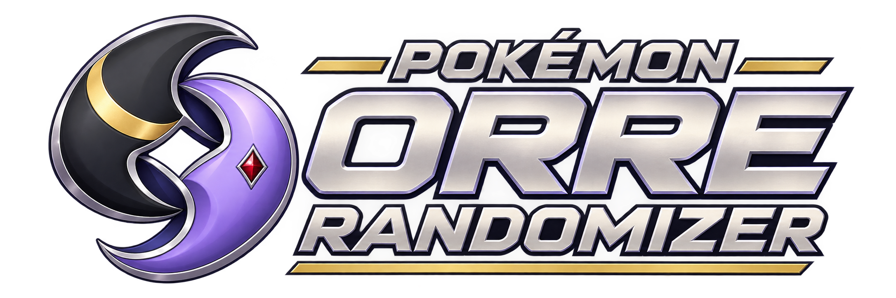
</p>

<p align="center">
  A free, open-source desktop randomizer for <strong>Pokémon Colosseum</strong><br>
  and <strong>Pokémon XD: Gale of Darkness</strong>.
</p>

<p align="center">
  <a href="https://github.com/KadenHD/pokemon-orre-randomizer/releases/latest">Download for Windows</a> ·
  <a href="docs/USER_GUIDE.md">User guide</a> ·
  <a href="docs/COMPATIBILITY.md">Supported ROMs</a> ·
  <a href="CHANGELOG.md">Changelog</a>
</p>

Pick a seed, preview your Pokémon, and create a separate ISO, GCM, or RVZ.
The Windows app runs locally and offers a Dolphin launcher for each run,
optional HD packs, and added game content.

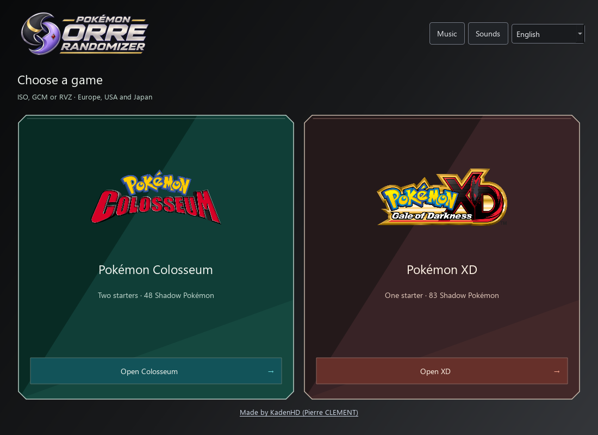

## Download and play

Get the Windows setup EXE or portable ZIP from the
[latest release](https://github.com/KadenHD/pokemon-orre-randomizer/releases/latest).
Both support Windows 10 and 11, 64-bit, and include Python and the native
conversion libraries. For portable use, extract the whole ZIP and open
`OrreRandomizer.exe` beside its `_internal` folder. Install Dolphin separately.

No ROMs or links to ROM downloads are provided. Use the randomizer only with game
images you are legally entitled to use. You are responsible for how you obtain,
use, and share those images. For the rights and sources of the game logos,
artwork, and music, see the [game media notices](THIRD_PARTY_NOTICES.md#game-interface-pack).

1. Choose Colosseum or XD, then select your unmodified ROM on the ROM page.
2. Choose a preset and seed in Settings. Preview your Pokémon before creating the ROM.
3. Review Applied settings on Create, choose an output, and select Dolphin if you want a game folder.
4. Open `Launcher.exe` in the new folder, click Play, and start a new game.

Every input format offers all three output formats. RVZ conversion is built in;
the app checks the decoded output against the generated ISO. GCM contains the
same disc data as ISO. Turn off Create a game folder with a launcher to produce
only a ROM for your usual emulator setup.

| Colosseum | XD |
| --- | --- |
| 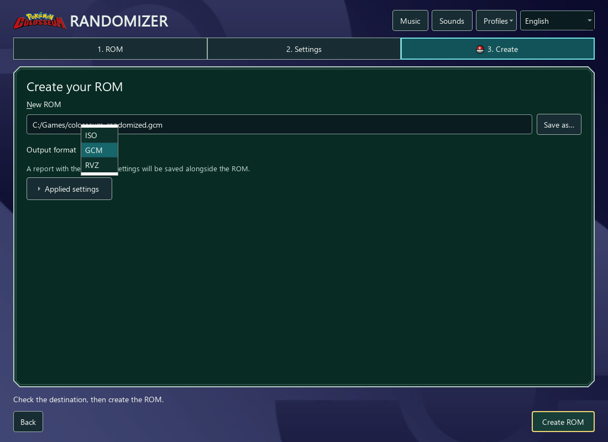 |  |

Home offers an in-place update when a newer stable app release is available.
The update verifies the download, preserves your files and preferences, and
restarts the app. You can cancel during download. The version check sends no
ROMs, paths, seeds, or saves; you can use the randomizer offline.

## Choose what changes

| Setting | Pokémon + moves | Pokémon only |
| --- | --- | --- |
| Trainers, starters, Shadow Pokémon, and ordinary gifts | Randomized | Randomized |
| Original legendary Shadow species | Preserved | Preserved |
| Legendary and Mythical Pokémon in random draws | Excluded | Excluded |
| Abilities | Randomized | Randomized |
| Starter evolution stages | All stages | All stages |
| Similar-strength matching | Off | Off |
| Evolution-family diversity | On | On |
| Seeded shiny chance for supported encounters | 5% | 5% |
| XD Poké Spots: a new shiny roll for every wild encounter | 5% | 5% |
| Accessible evolutions and evolution stones in shops | On | On |
| Encounter starting moves | Randomized | Species level-up moves |
| Level-up learnsets and TMs | Randomized | Preserved |
| Eligible treasure and shop items | Randomized | Preserved |
| Items already held by opponents | Randomized | Preserved |
| Colosseum's bonus quest | On, with its authored team | On, with its authored team |

Both presets keep the original levels, battle EXP, purification speed, and
catch rates. They preserve shop Poké Balls and seek different evolution
families for obtainable Pokémon; fixed encounters and strict filters can limit
that choice. Starters can come from any evolution stage, without power or type
matching. Colosseum's two starters have different families.

Pokémon only gives each replacement its species' level-up moves at the encounter
level. Empty slots stay empty when a species knows fewer moves. Pokémon + moves
draws moves without matching power, type, or physical/special stats, randomizes
TM compatibility, and keeps an attacking move. You can change the default
self-destruct and one-hit-KO exclusions in Advanced.

Advanced offers Original encounter moves, Species level-up moves, and Random
moves separately for trainers, starters, and gifts. Shadow moves and special
slots keep their own rules. Beldum, Metang, and Magikarp can be starters without
random moves. XD keeps its guaranteed Snag-only first capture, and a loss against
Chobin doesn't force another fight before Jovi's scene. Colosseum avoids drawing
two Teleport/Harden/Splash-only starters together; manual choices remain available.

Turn on Legendary and Mythical Pokémon under Advanced > Allowed Pokémon to
include them in random draws. Randomize legendary Shadow Pokémon controls
replacement of the original Shadow legends; XD001 keeps its story role.
The bonus Colosseum battle has separate controls for its team and final target.

The full preset randomizes ordinary Ball treasures, while story items, Time
Flutes, and guaranteed evolution stones stay available. Both presets keep every
Poké Ball originally sold in shops. Turn off Keep original Poké Balls in shops
to randomize those slots too. Pokémon without held items stay empty-handed.
See the [item and move rules](docs/USER_GUIDE.md) for shop coverage and exclusions.

Trade evolutions and other unavailable routes work within the selected game.
Evolution stones appear in Phenac and Pyrite shops in Colosseum and Gateon Port
in XD. Each Pokémon sheet lists the final evolution requirements.

| Colosseum settings | XD settings |
| --- | --- |
| 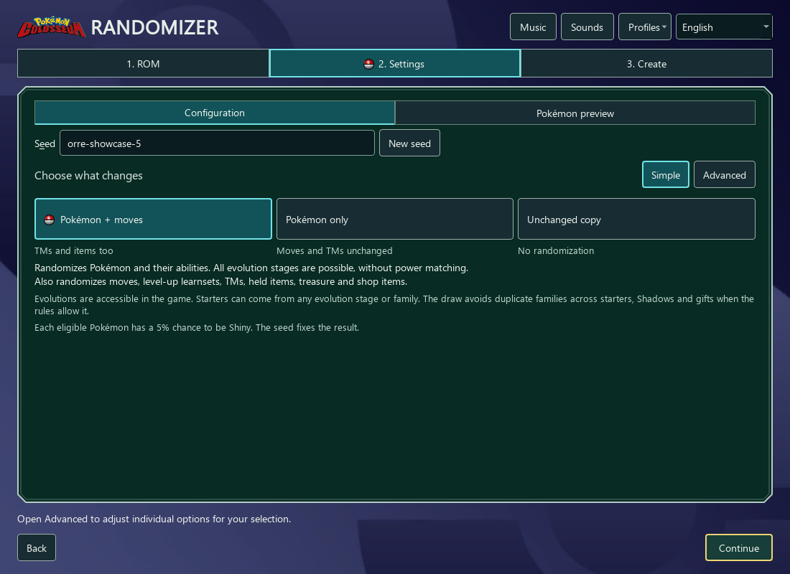 |  |

Unchanged copy preserves game data and converts between the supported formats.
Imported profiles keep their saved choices; selecting a preset applies the
current defaults. Older Colosseum profiles with unlinked custom shinies use
their seed so previews and supported in-game appearances agree.

### Optional Fairy rules

Add Fairy matchups, updated types for 18 species, and seven moves with
TM51-TM57 and natural learning. Both randomized presets turn this option on in
both games. You can turn off Add the Fairy type under Advanced > Types.
The [Fairy guide](docs/FAIRY_TYPE.md) lists
the moves, learning rules, animations, and GBA transfer restriction.

| Colosseum | XD |
| --- | --- |
| 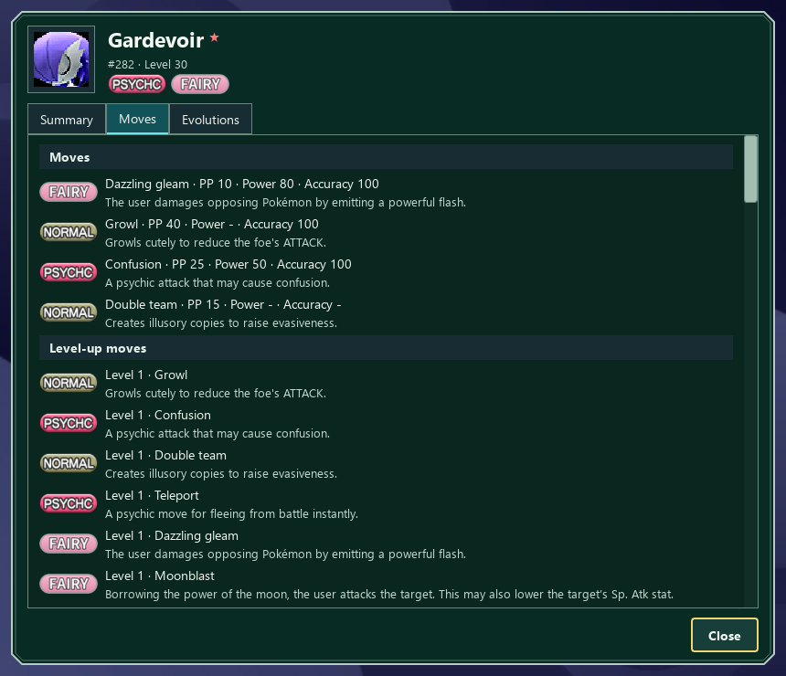 | 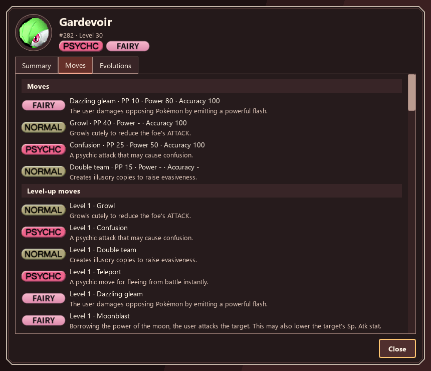 |

### Preview your run

Browse all 48 original Shadow Pokémon in Colosseum or 83 in XD, plus starters
and gifts. Kept Pokémon load automatically with their sheets and known shiny
status; click Calculate preview to draw randomized replacements.

Kept species retain their own abilities, moves, TM compatibility, types, and
stats. Advanced > Allowed Pokémon offers Randomize preserved Pokémon's properties
to apply your selected property rules to them too. Species share their data
tables, so preservation also protects their evolution families. Evolution and
Fairy rules still apply.

These fixed-encounter examples use a 100% shiny rate:

| Colosseum: kept Pokémon | XD: kept Pokémon |
| --- | --- |
|  | 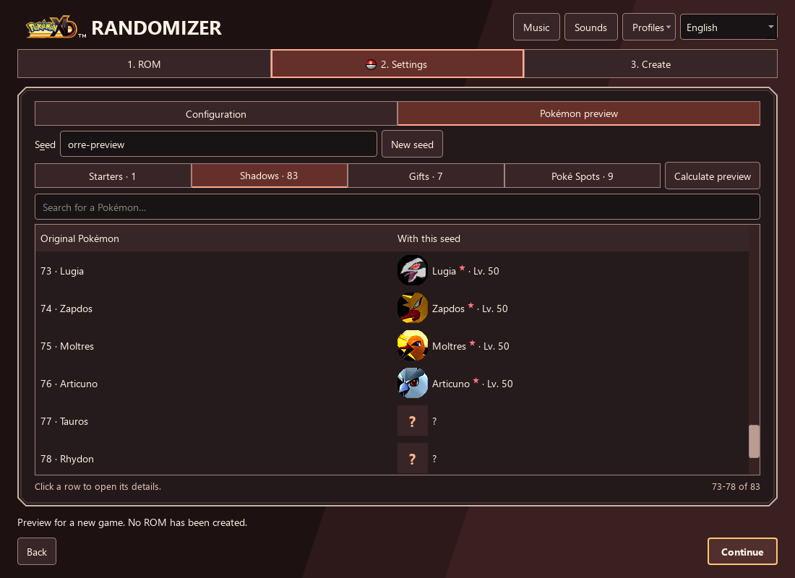 |

Click a row to open the replacement's Pokémon sheet. Gifts show their
requirements beside the Pokémon; XD's Poké Spots show the location and encounter
rate. Duking's trade requests follow the new rare encounters.

| Colosseum | XD |
| --- | --- |
| 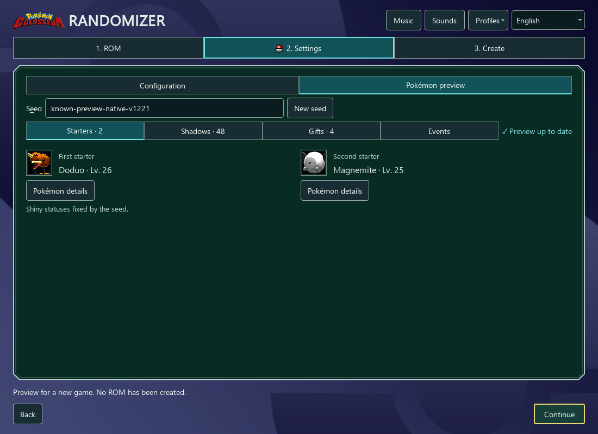 | 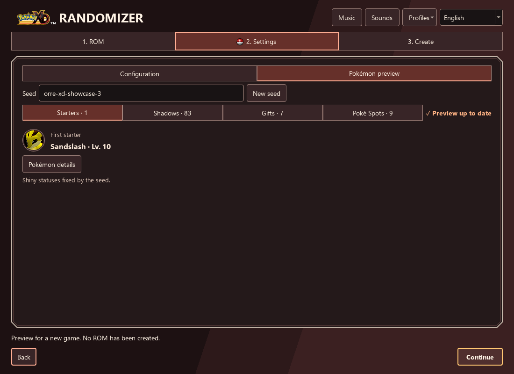 |
|  | 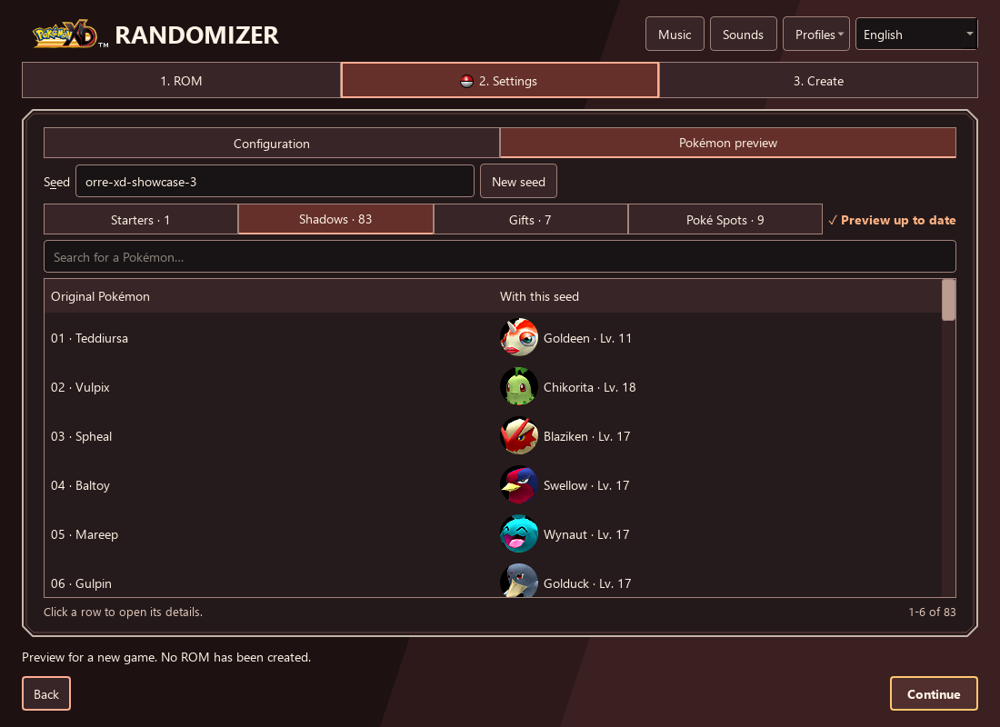 |
| 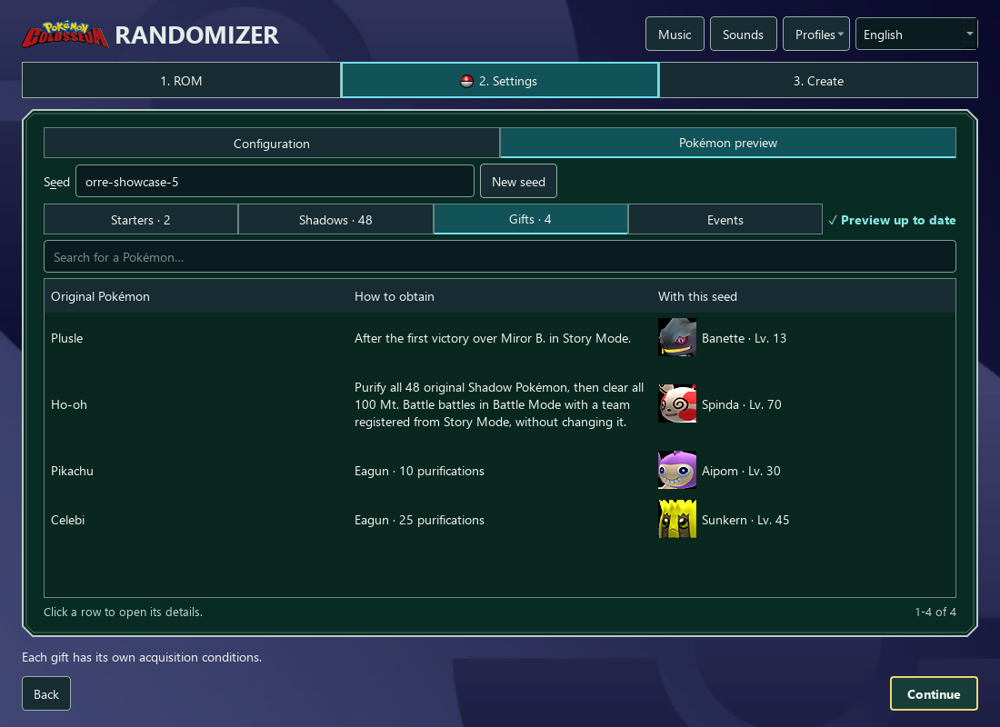 | 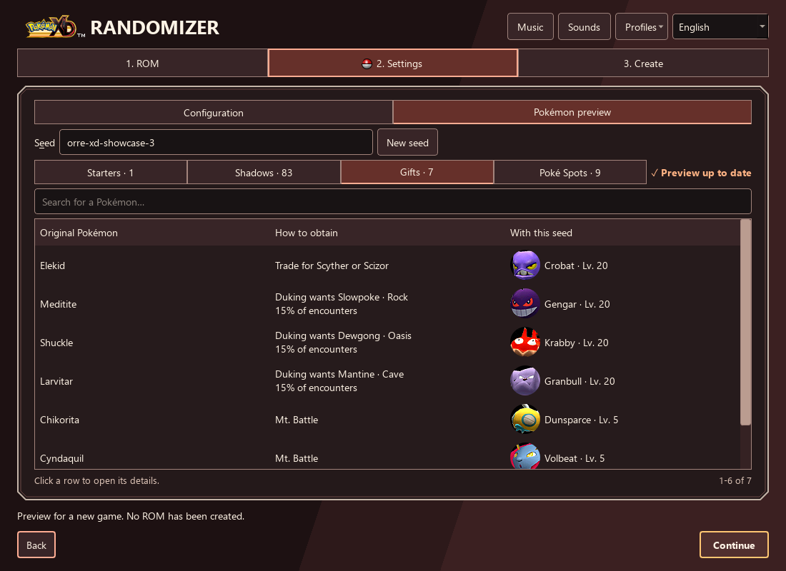 |

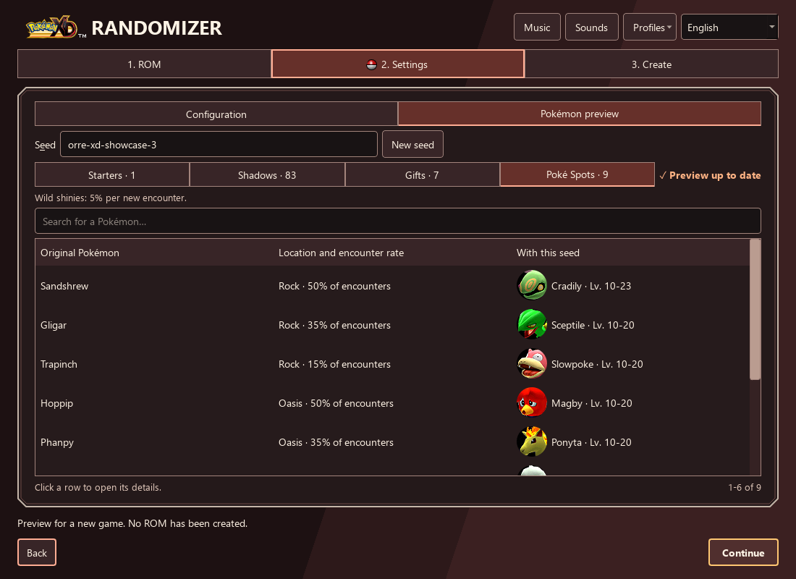

Colosseum's event gifts work without a distribution disc. With Make event gifts
obtainable on, Eagun offers Pikachu after 10 purifications and Celebi after 25
at the Relic Stone. You can randomize the gifts and change their thresholds and
levels. His story dialogue, contact exchange, and Master Ball handoff take
priority. The Events tab also previews the
[postgame battle](#a-new-postgame-battle-in-colosseum).

## In game

Your replacements appear in battles and supported story scenes in both games.

| Pokémon Colosseum | Pokémon XD |
| --- | --- |
|  |  |

### Randomized Pokémon in story scenes

The starters at Outskirt Stand, Duking's gift in Pyrite, and Miror B.'s dancers
use your replacements in supported scenes. Dialogue follows the changed teams,
including references to types and moves. XD's Battle Simulator lessons follow
their new rental teams too. The prerecorded opening movies stay original.


[Motorcycle still](docs/images/colosseum-motorcycle-starters.png)

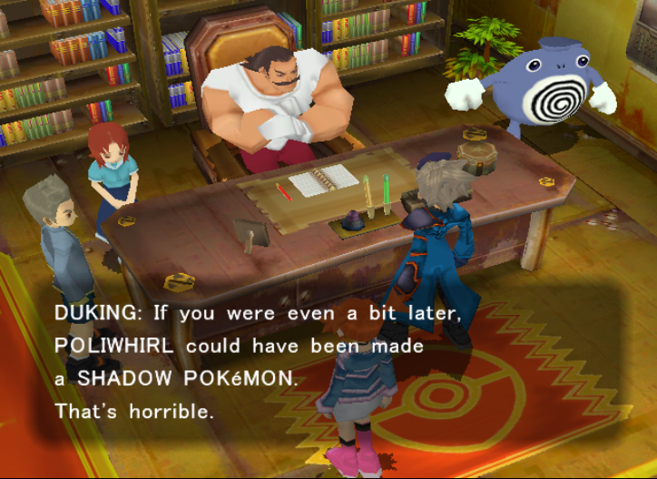

| Colosseum: Pyrite Cave | XD: Gateon Port Lighthouse |
| --- | --- |
|  |  |

[Pyrite Cave still](docs/images/colosseum-pyrite-dancers.png)

Unown's letter comes from the seed; Spinda's spots follow its personality value.
The Pokémon sheet shows the pattern when the app can determine it before play.
See [story-scene support](docs/reverse-engineering/STORY_GIFT_SCENES.md),
[form rules](docs/SHINIES.md), and the [shiny model audit](docs/SHINY_MODEL_COVERAGE.md).
[Capture seeds and versions](docs/images/manifest.json) accompany the gallery.

At XD's Poké Spots, a shiny appears in the field before battle:

| Cave Poké Spot | Wild battle |
| --- | --- |
| 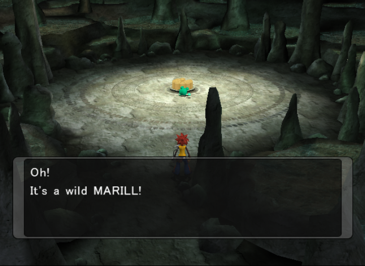 | 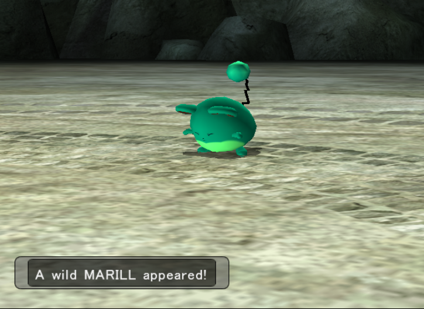 |

### Deoxys forms

Both games support all four Deoxys forms. A reusable METEORITE in the field
Bag changes a party Deoxys's form, including a Shadow Deoxys, without changing
its shiny status or purification progress. Each randomized Deoxys starts with
a seeded form and keeps its saved form through party/PC transfers and saving.
Models and portraits support Original and HD modes.
[Deoxys and Meteorite guide](docs/DEOXYS_FORMS.md).

| Pokémon Colosseum | Pokémon XD |
| --- | --- |
| 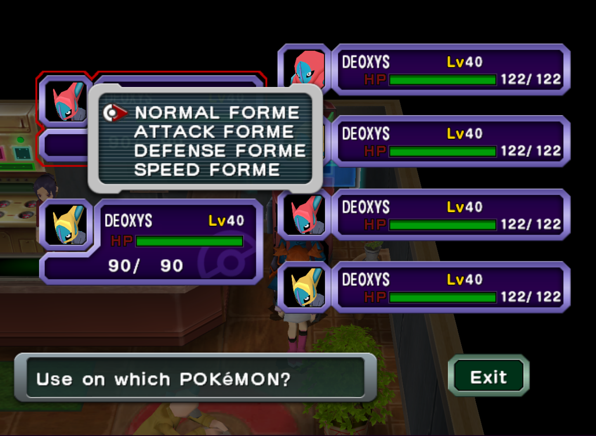 | 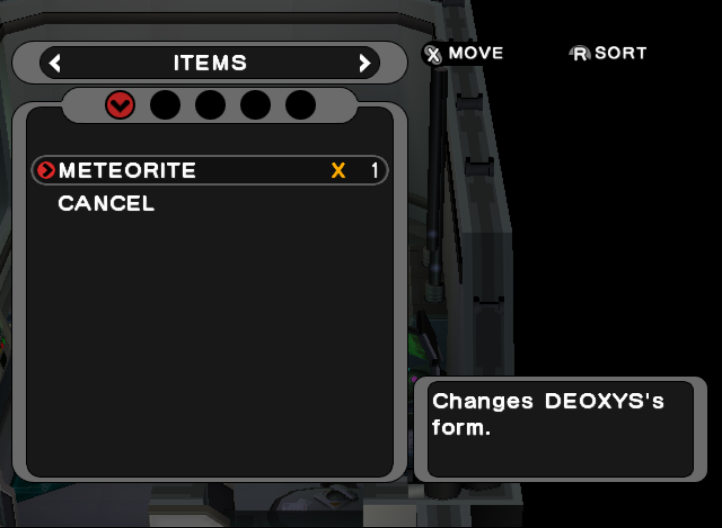 |

### Choose your shiny odds

Set a rate from 0% to 100% in Advanced, including XD's normally shiny-locked
Shadow Pokémon. The seed fixes the shiny result for supported starters, gifts,
and trainer/Shadow encounters. A shiny stays shiny after capture, evolution,
and purification. XD's wild Poké Spots use a separate rate and roll again for
each new encounter; the result stays the same on the field, in battle, and after capture.

### Shadow forms for Legendary and Mythical Pokémon

All 21 Legendary and Mythical Pokémon have Shadow and shiny Shadow models in
both games, including all four Deoxys Formes. The randomizer preview uses the
same portraits as the game. The HD packs add 4× textures and portraits.

Purification restores each Pokémon's usual appearance and keeps its shiny
status. Turn on **Keep legendary Shadow appearances** in Advanced > Shinies
to retain the Shadow model and portrait. The option starts off and applies
only to former Shadow Pokémon. [Shiny rules](docs/SHINIES.md).

| Colosseum | XD |
| --- | --- |
| 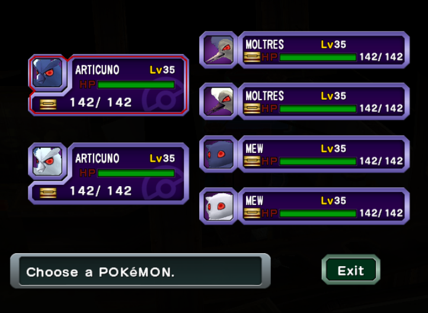 | 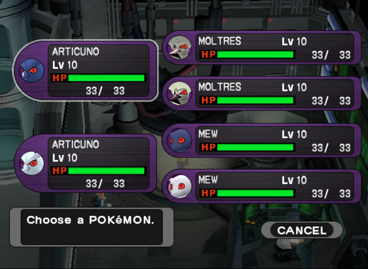 |

### A new postgame battle in Colosseum

After you snag and purify the original 48 Shadow Pokémon, Eagun sends a P★DA
warning on your next motorcycle trip to another area. Return to Agate's Relic
Stone to face Nascour and level-70 Shadow Lugia in a scene with your partner
and Eagun.

| Cipher's last stand | After the capture |
| --- | --- |
| 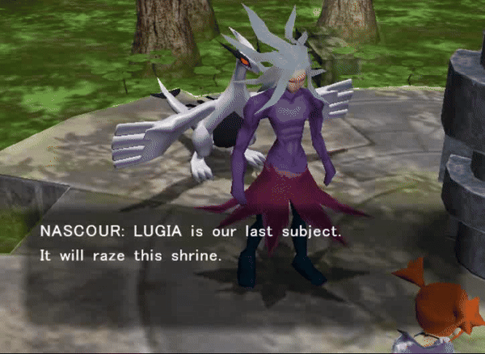 |  |

Both presets turn on the quest with its authored six-Pokémon team at levels
65-70. Miss the capture and you can challenge Nascour again. Snag the final
Shadow Pokémon and he leaves the shrine; Eagun resumes his purification rewards.
You can purify the new Pokémon normally. Ho-Oh's requirements still count the
original 48.

Advanced > Starters and gifts offers separate switches to randomize Nascour's
first five Pokémon and the final Shadow target. Both start off, and the scene
follows the replacement if you turn them on. Use Pokémon preview > Events to
inspect the team or turn off the quest.
[Quest guide](docs/USER_GUIDE.md#colosseums-optional-shadow-lugia-event).

## A launcher for each run

Keep a run's ROM, cards, save states, controls, and Dolphin profile in one folder.
The app detects Dolphin when possible or lets you select it. `Launcher.exe`
reopens the run after you close the randomizer and uses its own `DolphinUser/`
profile. Generated filenames stay in English.

Every launch starts at 100%. Choose a 100%, 200%, or 300% fast-forward target:
hold Tab to use it, Ctrl + Tab to toggle it, or Shift + Tab to slow to 50%.
Choose corrected 16:9 or original 4:3 in borderless fullscreen, and remap the
keyboard or XInput controller presets in Dolphin.
[Launcher controls and display support](docs/GAME_FOLDERS.md).

| Colosseum launcher | XD launcher |
| --- | --- |
| 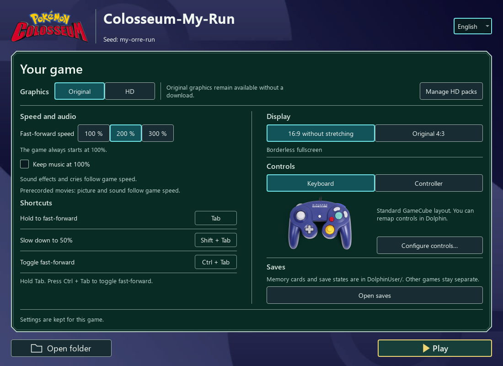 | 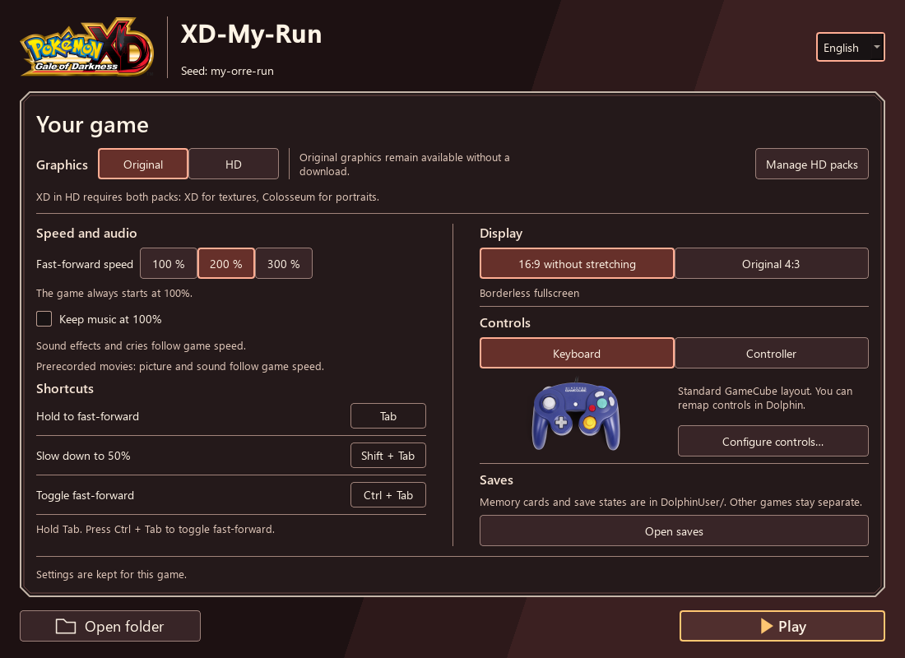 |

Keep music at 100% starts on where supported: Windows, verified Europe
revision-0 images, and the checked music bridge/renderer. Gameplay music stays
at normal speed while effects, cries, and prerecorded movies follow game speed.
Other configurations use native audio.
[Audio requirements and validation](docs/reverse-engineering/NATIVE_MUSIC_HOST.md).

Home's Update a launcher command updates an existing run's launcher and backs up
the previous files. Opening a run alone keeps its recorded version; the update
leaves its ROM, saves, controls, and pack versions unchanged.

## Shared HD packs

Install the optional packs from Home or either launcher. Each app release pins
reviewed pack versions and checks their hashes. Runs share each installed pack;
existing folders keep their recorded version. Downloads support cancellation
and resuming. Original mode needs no pack download.

The packs come from Sephie
([Colosseum, published by u/Bun-bun45](https://www.reddit.com/r/DolphinEmulator/comments/sxzxi2/))
and mikeyX ([XD/XG](https://forums.dolphin-emu.org/Thread-pokemon-xg-xd-hd-texture-pack-v1-0)).
See [pack sources and rights](docs/HD_SOURCES.md).

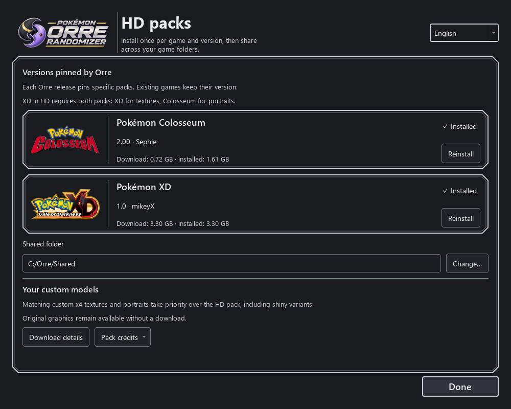

The Colosseum download is about 0.72 GB; the XD pack is about 3.30 GB. XD needs
both packs because it uses Colosseum's HD portraits for all 386 base species and
Unown forms, adapted to round frames. Installing XD retrieves both missing packs.
Imported models can also require the other game's pack.

Custom x4 textures and artwork use the pinned HD packs as donors, while native
models stay in the ROM. Missing custom artwork stops HD preparation. The packs
add no polygons or HQ audio, and prerecorded movies keep their original resolution.
Menu and text coverage varies by region and language; some artwork stays native.
See [HD coverage](docs/HD_COVERAGE.md) before choosing a pack.

Castform's battle portrait follows its weather form. Shiny Sunny, Rainy, and
Snowy forms have matching native and x4 artwork using their modern colors.
Castform keeps Forecast, which other species can't receive through randomization.
Weather forms and Deoxys's additional forms use HD materials with the games'
native meshes and animations. Create a new ROM to add the custom resources.

| Colosseum | XD |
| --- | --- |
| 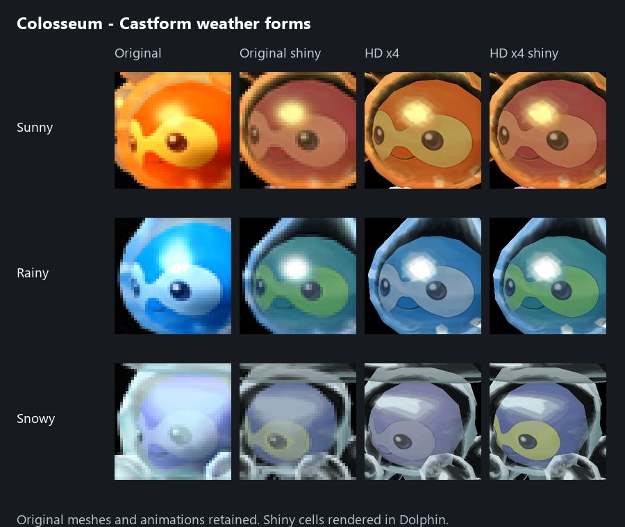 | 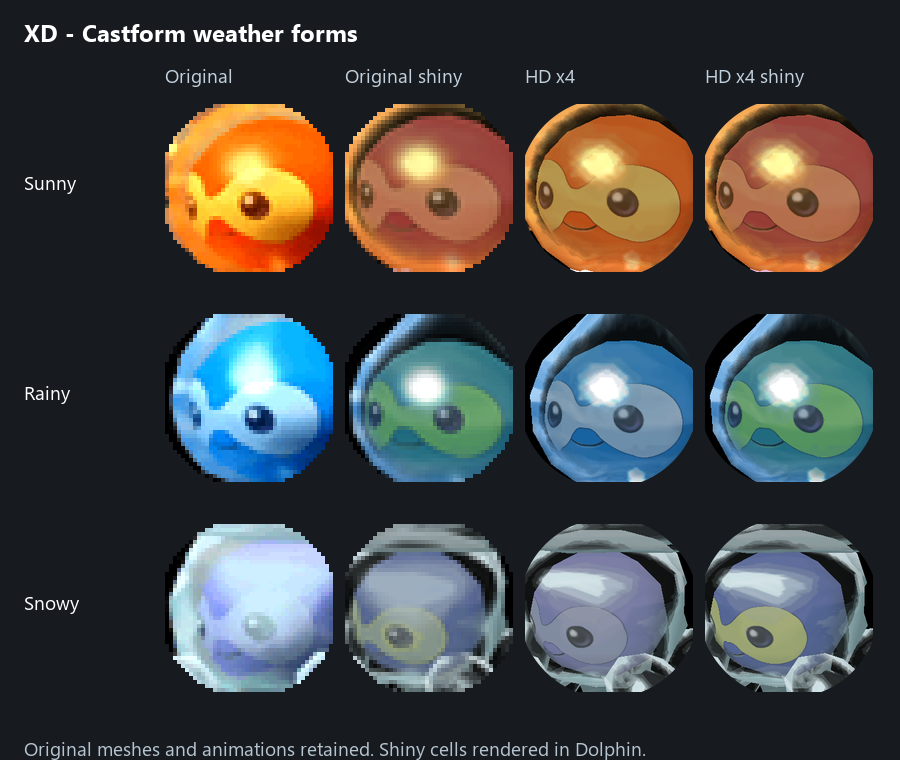 |

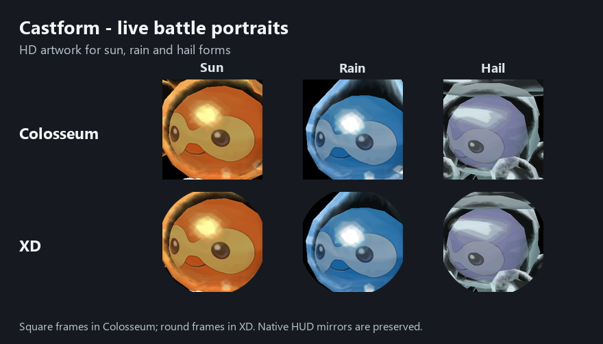

Shadow Lugia's normal/shiny portraits use violet square frames in Colosseum and
round frames in XD. The DNA lab uses separate whole-body artwork with matching
native/HD poses and a black outline.

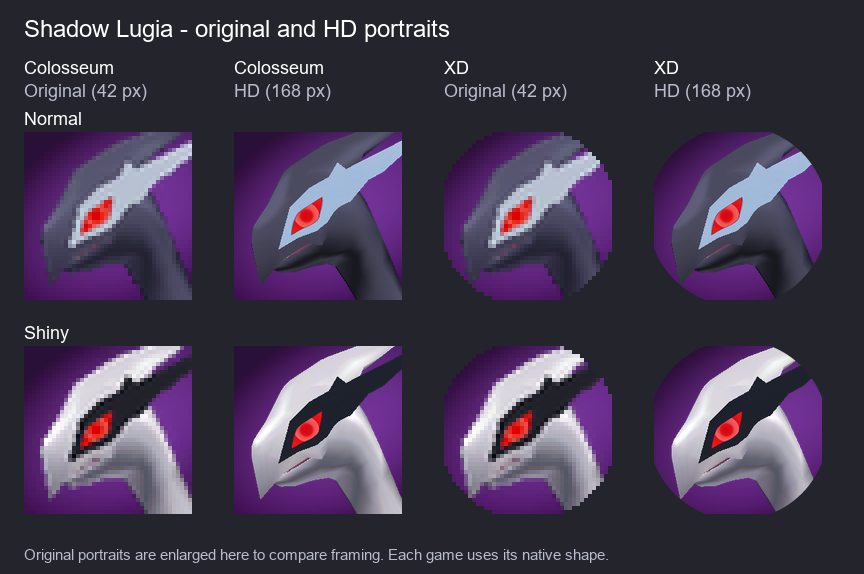

HD menus include localized type/status labels, battle controls, title menus,
European XD health notices, and P-AD captions. New game folders support vector
lettering with the original spacing and dialogue layout. XD's VS illustrations
combine game character models with authentic hardware photos.

| Colosseum | XD |
| --- | --- |
| 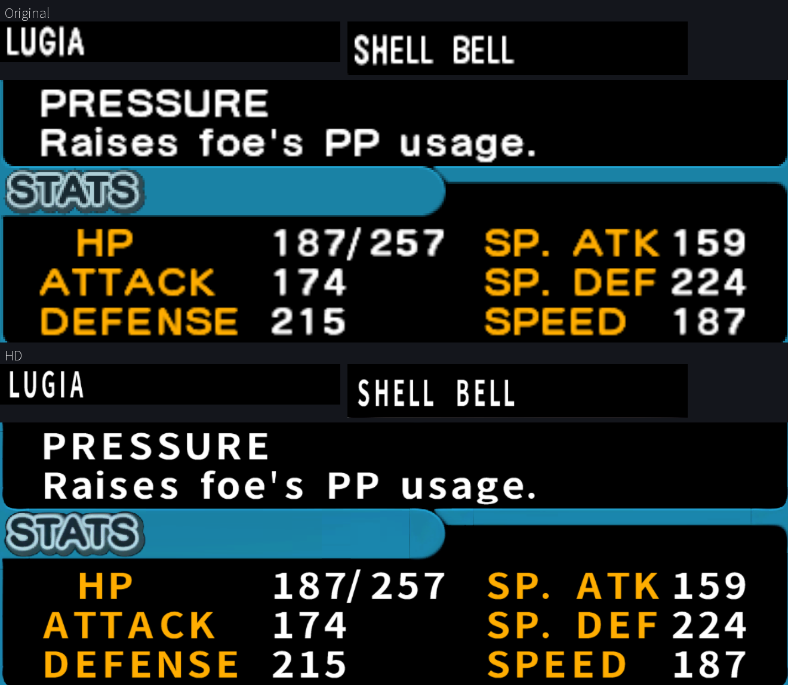 |  |

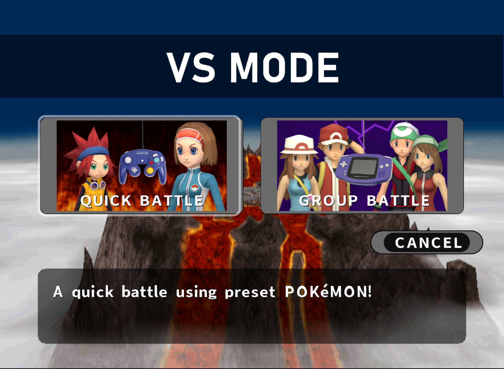

The shared cache also stores runtimes and extracted music when supported.
Moving a run to another PC requires locating Dolphin and reinstalling its
shared resources. [Game-folder guide](docs/GAME_FOLDERS.md).

## What you can customize

| Settings | Controls |
| --- | --- |
| Pokémon | Species, stages, generations, exclusions, power matching, family diversity |
| Battles | Moves, learnsets, TMs, abilities, types, stats, held items, trainer themes, boss teams, levels |
| Progression | Evolutions, stones, EXP, purification, capture rates, treasure, shops |
| Run | Seed, profiles, previews, sheets, reports, offline HTML journal |

Both games share the three-page layout and Pokémon sheets, with their own logos,
backgrounds, and title music. The included interface pack works before you select
a ROM. Music and Sounds have separate saved preferences.

| Game feature | Colosseum | XD |
| --- | --- | --- |
| Starters | Two, originally Umbreon and Espeon | One, originally Eevee |
| Original Shadow roster | 48 groups | 83 encounters |
| Gifts and trades | Plusle, Ho-Oh, Pikachu, Celebi | Duking's trades, Hordel's trade, Mt. Battle prizes |
| Special encounters | Eagun's purification rewards | Tutorial Teddiursa and Hordel's Shadow Togepi, both randomized by default |
| Poké Spots | Not available | Full supported Pokédex, subject to filters; Duking's requests follow the rare slots |

Sheets read the final patched data and show evolution routes, TM compatibility,
and localized ability/move descriptions. Evolution portraits follow the Pokémon's
known shiny status.

| Colosseum | XD |
| --- | --- |
|  | 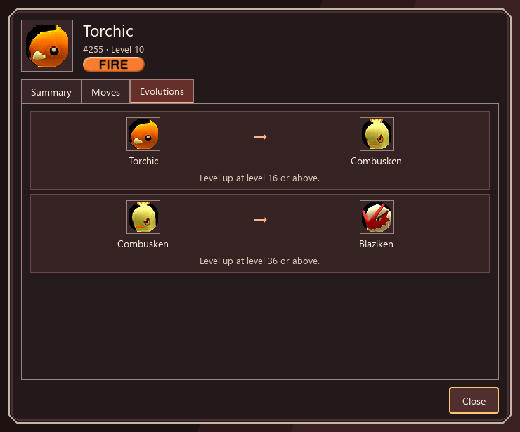 |
|  |  |

### Advanced settings

Search for an option or choose a category. Reset a category on its own, or switch
between Simple and Advanced without losing your choices. The
[user guide](docs/USER_GUIDE.md) covers each rule and its limits.

| Colosseum move settings | XD move settings |
| --- | --- |
| 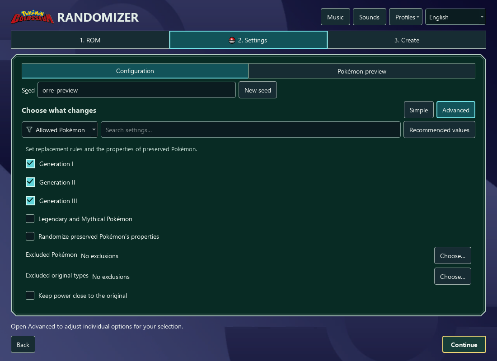 | 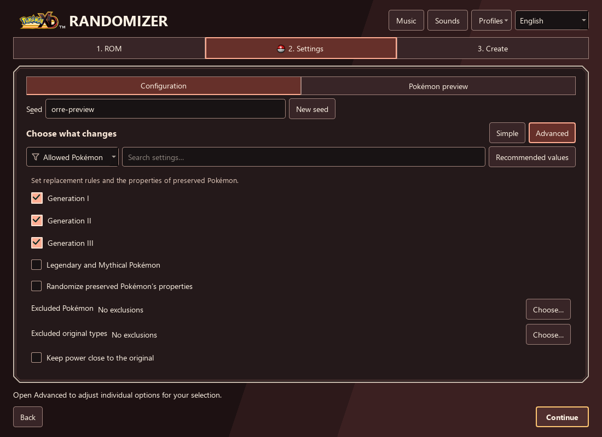 |

## Manage your runs

My games lists your runs with seeds, launcher versions, and links to Play,
folders, and card backups. The launcher can back up cards before play, keeping
up to five copies with verified restoration. Storage offers cleanup of old,
rebuildable texture views.

| My games | Save backups |
| --- | --- |
| 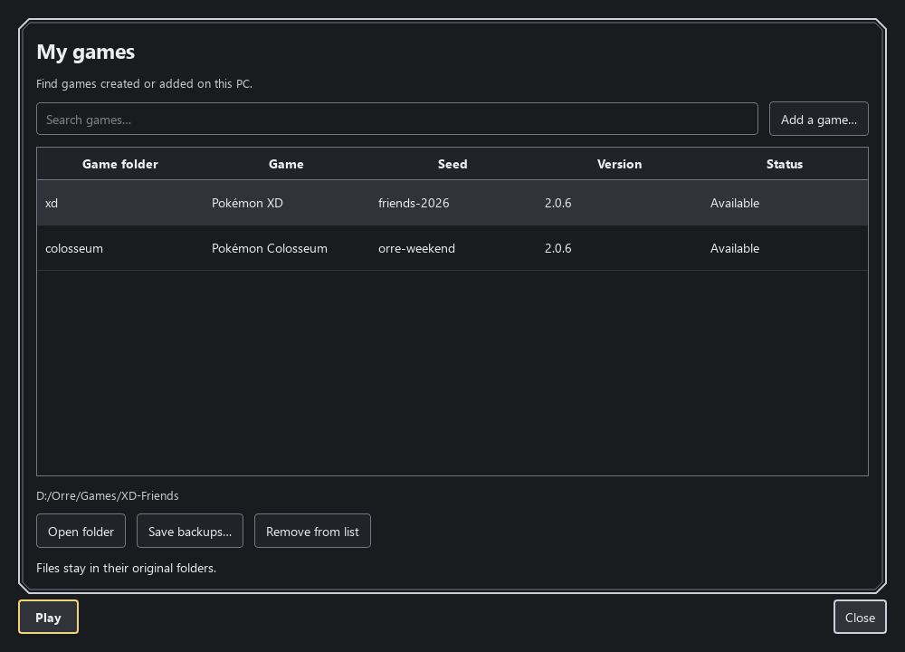 | 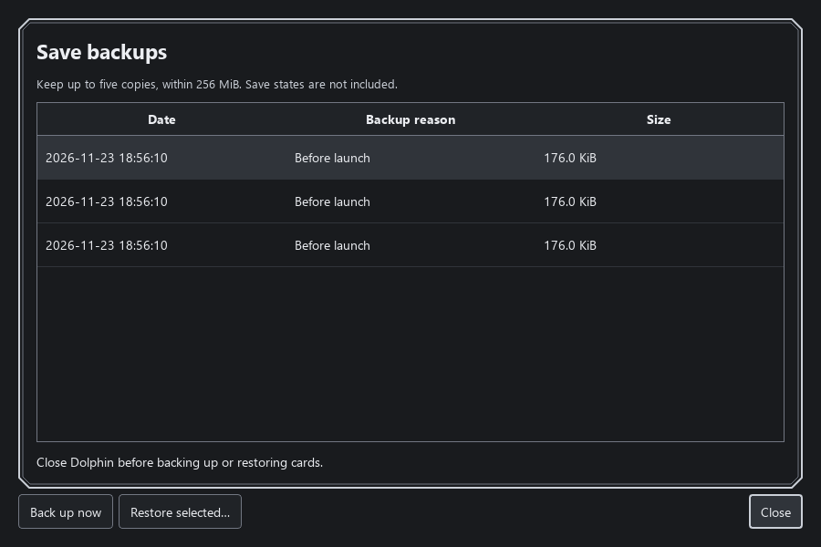 |

Challenge codes share a seed and settings without local paths and check engine
compatibility on import. For a bug report, Profiles > Export diagnostic lets you
review a local JSON file with the failed attempt's settings and an optional seed.
The export omits ROMs, saves, paths, and raw logs, and uploads nothing.
[Run-management guide](docs/RUN_MANAGEMENT.md).

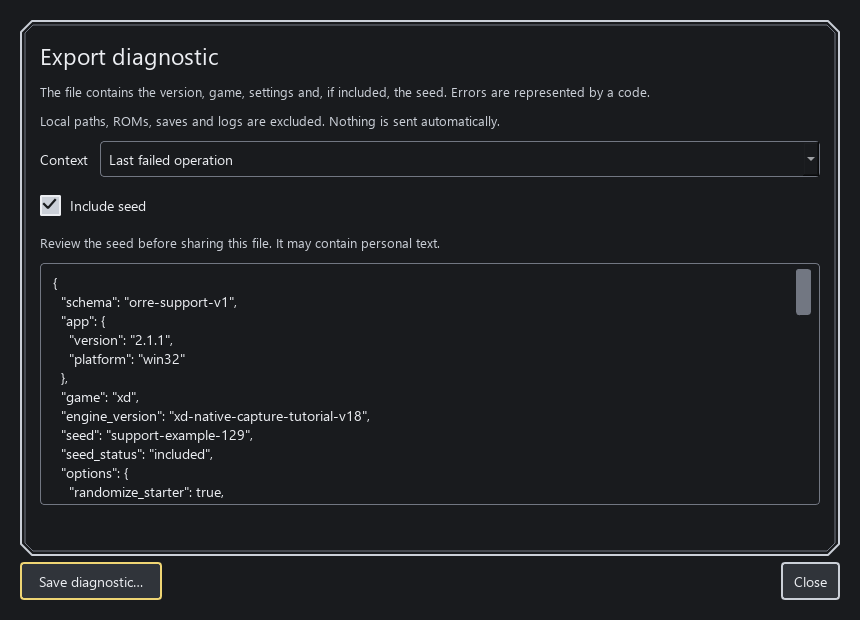

## Compatibility and languages

Use revision 0 of either game from Europe, USA, or Japan:

| Game | Europe | USA | Japan |
| --- | --- | --- | --- |
| Colosseum | `GC6P01` | `GC6E01` | `GC6J01` |
| XD | `GXXP01` | `GXXE01` | `GXXJ01` |

The decoded ISO must match a [supported original hash](docs/COMPATIBILITY.md).
The app rejects modified images and unknown revisions.

The interface supports English, French, German, Spanish, Italian, and Japanese.
It follows your system language, falls back to English, and lets you change
language at any time. In-game names and dialogue follow the ROM's languages,
independently of the app.

## Reproducing a run

Keep the output's JSON report or export a profile from Profiles. The same
original image, exact seed text, settings, and engine version produce the same
decoded disc. RVZ bytes can also depend on the converter version recorded in
the report. Start a new game to match the preview; existing saves retain Pokémon
the game has already generated.

Automated checks cover both engines, six interface languages, packaging,
profiles, and isolated Windows startup. Dolphin checks cover selected scenarios,
not full playthroughs of every region or seed. Read the
[validation reports](docs/VALIDATION.md) for the tested scope.

## Run from source

Use Python 3.12 or later:

```powershell
python -m venv .venv
.\.venv\Scripts\Activate.ps1
python -m pip install -e .
python -m orre_randomizer
```

ISO/GCM processing works with the Python LZSS codec. For RVZ conversion and
LZSS acceleration in a source checkout, install Rust and a C/C++ toolchain
(MSVC on Windows), then run `python scripts/build_native.py`. The build fetches
pinned dependencies once. The Windows release includes both libraries for
offline conversion; the Python and Rust LZSS codecs produce the same bytes.

Use a profile to reproduce the GUI's settings through the CLI:

```powershell
python -m orre_randomizer.cli original.iso new-game.iso --profile my-run.json
python -m orre_randomizer.cli xd-original.iso xd-new.iso --game xd --profile my-xd-run.json
python -m orre_randomizer.cli --help
python -X utf8 scripts/run_tests.py
```

See [Contributing](CONTRIBUTING.md), the [release guide](docs/RELEASE.md), and
[research notes](RESEARCH.md). Include the version, game, region, seed, and
settings in bug reports. Check reports for local paths before sharing them.

The application code and original Orre branding use the [MIT license](LICENSE).
Game media and third-party libraries have separate rights and provenance in the
[third-party notices](THIRD_PARTY_NOTICES.md).
