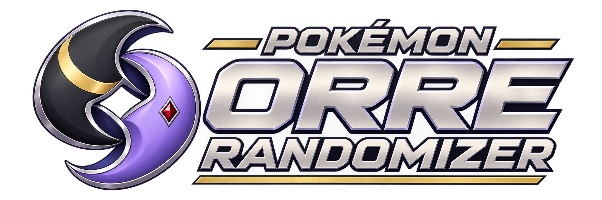
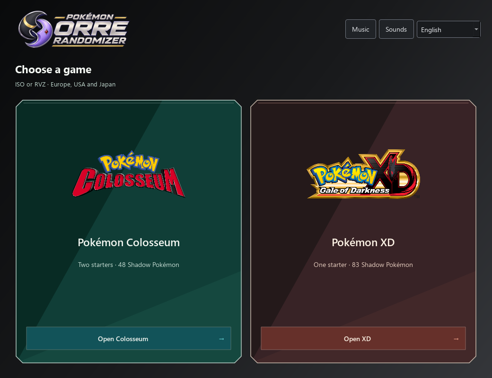
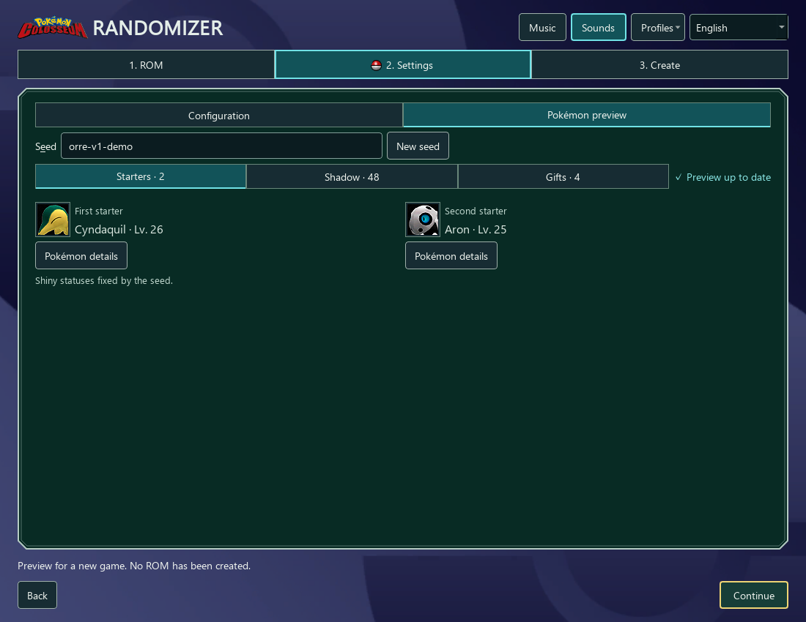
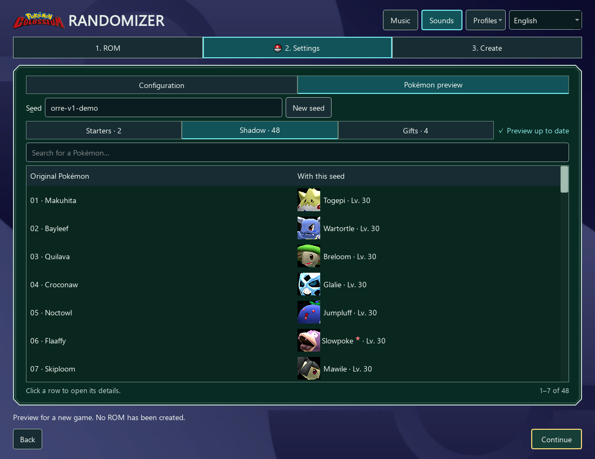
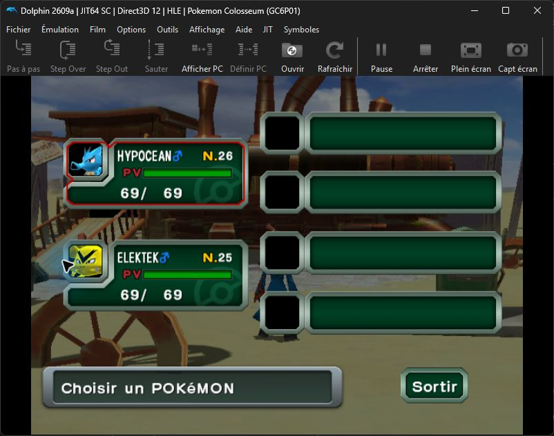
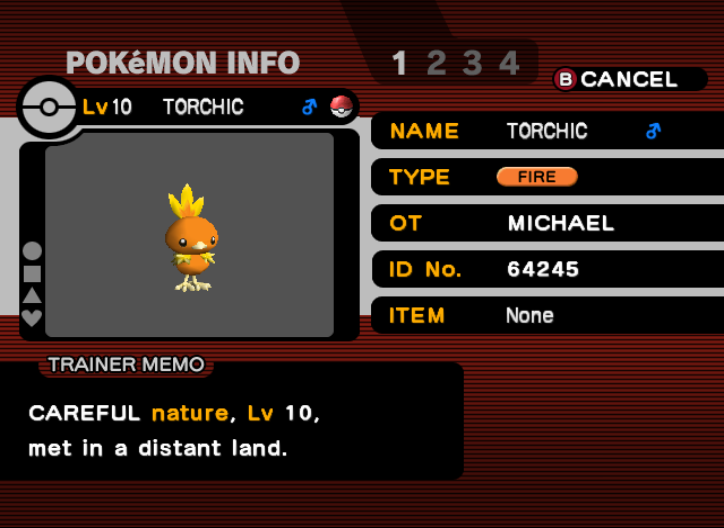
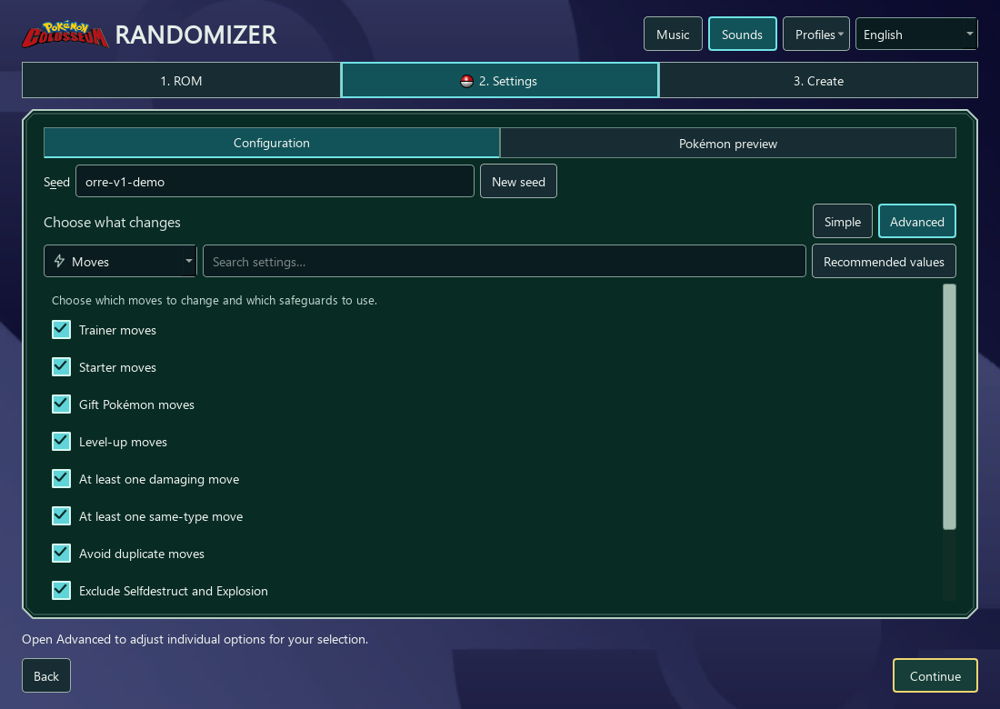
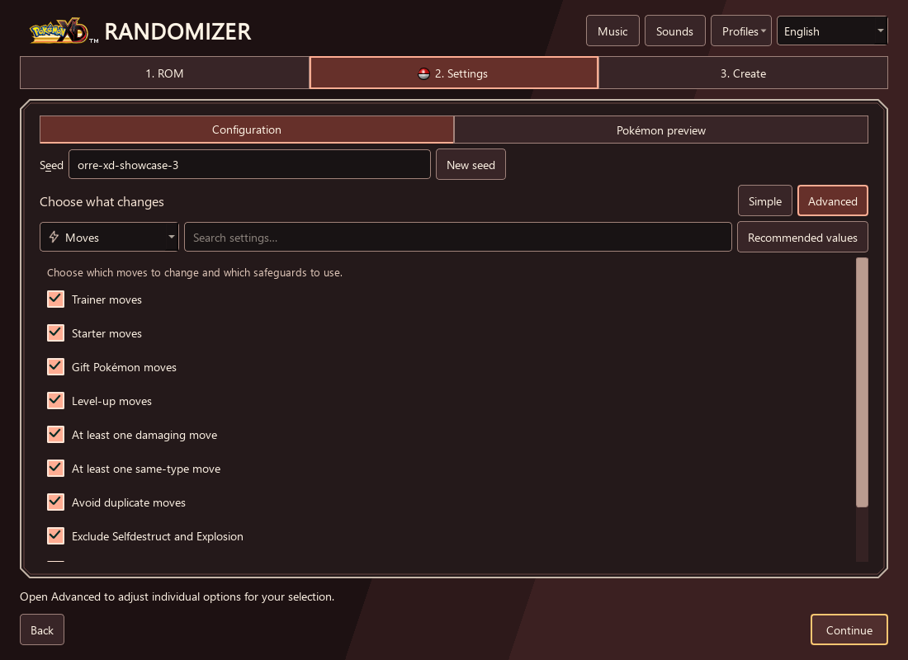
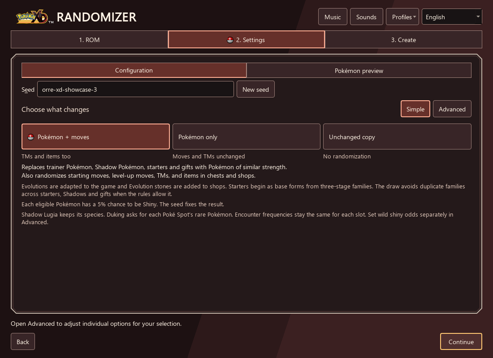
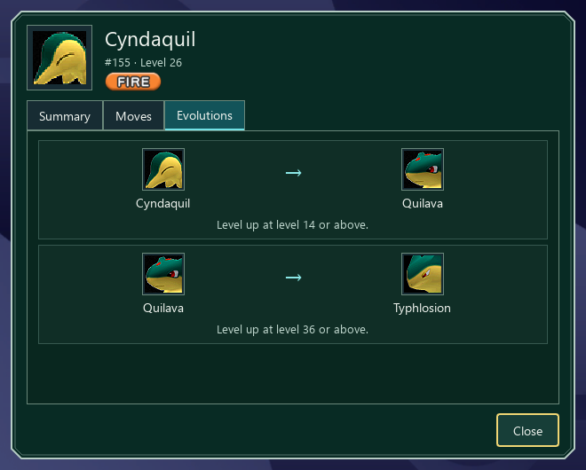

<p align="center">
  
</p>

<p align="center">
  A free, open-source desktop randomizer for <strong>Pokémon Colosseum</strong><br>
  and <strong>Pokémon XD: Gale of Darkness</strong>.
</p>

<p align="center">
  <a href="https://github.com/KadenHD/pokemon-orre-randomizer/releases/latest">Download for Windows</a> ·
  <a href="docs/USER_GUIDE.md">User guide</a> ·
  <a href="docs/COMPATIBILITY.md">Supported ROMs</a> ·
  <a href="CHANGELOG.md">Changelog</a>
</p>

Choose your game, supply a clean ISO or RVZ, and create a new adventure from a
seed. Everything runs locally. Your original ROM is preserved, and the app
writes a separate, verified image with a settings report and an offline journal.
No ROM, save file, or emulator is included.



## Download and play

**Version 1.2.6** adds original type badges to Pokémon sheets in Colosseum and
XD and displays move names in sentence case. See the [release notes](docs/releases/v1.2.6.md).

Download the **Windows setup EXE** from the
[latest release](https://github.com/KadenHD/pokemon-orre-randomizer/releases/latest)
for Windows 10 or 11, 64-bit. Python and the Rust codec are included.
For portable use, extract the **Windows ZIP** in full and open `OrreRandomizer.exe`
beside its `_internal` folder.

No ROMs or links to ROM downloads are provided. Use the randomizer only with game
images you are legally entitled to use. You are responsible for how you obtain,
use, and share those images. For the rights and sources of the game logos,
artwork, and music, see the [game media notices](THIRD_PARTY_NOTICES.md#game-interface-pack).

1. Choose **Colosseum** or **XD**, then select your original ROM in **ROM**.
2. In **Settings**, choose a preset and a seed. Preview the starters, Shadow
   Pokémon and gifts, or open **Advanced** to adjust individual rules.
3. In **Create**, review **Applied settings** and choose a new ISO or RVZ path.
4. Open the output in Dolphin and start a new game.

ISO input and output work directly. Reading or writing **RVZ** requires
`DolphinTool.exe` from your [Dolphin installation](https://dolphin-emu.org/download/).
The relevant page shows its path field, and the suggested output format matches
your input. The app does not launch Dolphin or manage your saves.

## Two presets, one balance policy

| | Pokémon + moves | Pokémon only |
| --- | --- | --- |
| Trainers, starters, Shadow Pokémon and ordinary gifts | Randomized | Randomized |
| Similar-strength replacements and family diversity | Enabled | Enabled |
| Base-form starters from three-stage families | Enabled | Enabled |
| Seeded 5% shiny chance for supported encounters | Enabled | Enabled |
| Accessible evolutions and evolution stones in shops | Enabled | Enabled |
| Starting moves, level-up learnsets and TMs | Randomized | Preserved |
| Eligible treasure and shop items | Randomized | Preserved, with evolution stones added |

Both presets retain native opponent levels, battle EXP, purification speed and
catch rates. Colosseum also balances its two starters as a pair, with distinct
families and complementary types. XD has one starter. Its custom rate covers
the starter, ordinary gifts and Shadow Pokémon; the Shadow unlock can be
disabled separately. Wild Poké Spots retain their native shiny odds.
Family diversity is best effort when fixed Pokémon or strict filters
leave no alternative.

**Unchanged copy** preserves game data and can convert ISO ↔ RVZ. Imported
profiles keep their saved settings, including defaults from older versions.
Selecting a preset applies the current defaults.



Preview all 48 Colosseum Shadow Pokémon and their replacements before creating
the ROM. Each row opens the replacement's Pokémon sheet with a single click.



## In game

Real starter screens from earlier Dolphin playtests, with the games in French.
These are examples of custom runs; the current presets are described above.

| Pokémon Colosseum | Pokémon XD |
| --- | --- |
|  |  |
| Seadra, level 26, and Electabuzz, level 25. | Horsea, level 10, from a 100% shiny test. |

The [Colosseum](docs/DOLPHIN_VALIDATION_2026-10-31.md) and
[XD](docs/reverse-engineering/XD.md) validation notes record their test scope.

## What you can customize

- **Pokémon:** species, evolution stages, generations, legendary restrictions,
  excluded species and types, similar strength, and evolution-family diversity.
- **Battle data:** moves, learnsets, TMs, compatibility, abilities, types, base
  stats, held items, trainer themes, boss teams and opponent level scaling.
- **Progression:** obtainable evolutions, evolution stones, battle EXP,
  purification speed, catch rates, treasure and shop stock.
- **Your run:** reproducible seeds, profile import/export, encounter previews,
  Pokémon sheets, verification reports and an offline HTML journal.

Both games use the same three-page layout and Pokémon sheets, with their own
logos, backgrounds and title music. The included interface pack works before
you select a ROM. **Music** and **Sounds** have separate saved preferences.

| Game-specific behavior | Colosseum | XD |
| --- | --- | --- |
| Starters | Two, originally Umbreon and Espeon | One, originally Eevee |
| Shadow roster | 48 synchronized Shadow groups | 83 Shadow encounters; Shadow Lugia is protected |
| Gifts and trades | Plusle, Ho-Oh, Pikachu and Celebi | Duking's trades, Hordel's trade and Mt. Battle prizes |
| Special encounters | Event gifts can be earned from Eagun after purification milestones | Tutorial Teddiursa and Hordel's Shadow Togepi are randomized by default; each can be disabled separately |
| Poké Spots | — | Draw from the full supported Pokédex, subject to filters and power matching; Duking's requests follow the new rare slots |

The [user guide](docs/USER_GUIDE.md) explains these rules and their limits.
Pokémon sheets read the final patched game data, including evolution routes,
moves and TM compatibility.

### Advanced settings

Choose a category or search for an option. Each category can be reset on its
own; switching between Simple and Advanced keeps your settings.

| Colosseum · move rules | XD · shiny rules |
| --- | --- |
|  |  |





## Compatibility and languages

Supported originals are **revision 0** of both games in **Europe, USA and Japan**:

| Game | Europe | USA | Japan |
| --- | --- | --- | --- |
| Colosseum | `GC6P01` | `GC6E01` | `GC6J01` |
| XD | `GXXP01` | `GXXE01` | `GXXJ01` |

The full decoded ISO hash must match a supported original. Modified images and
unknown revisions are rejected. See [exact hashes and compatibility](docs/COMPATIBILITY.md).

The interface supports **English, French, German, Spanish, Italian and Japanese**.
It follows your system language, falls back to English, and can be changed at
any time. This does not change the ROM's language. In-game names and patched
dialogue follow the languages supported by that ROM.

## Reproducing a run

Keep the output's `.json` report or export a profile from **Profiles**.
The same original image, seed, settings and engine version produce the same
ISO. RVZ compression bytes can also depend on the DolphinTool version.
Seeds are exact text: case and spaces matter. Existing saves can retain
Pokémon already generated by the game, so use a new game to match the preview.

Automated checks cover both engines, six interface languages, packaging,
profile compatibility and isolated Windows application startup. Selected
scenarios have also been checked in Dolphin. These are not full playthroughs
of every region or seed; [validation scope and evidence](docs/VALIDATION.md)
describe what was tested.

## Run from source

Use Python 3.12 or later:

```powershell
python -m venv .venv
.\.venv\Scripts\Activate.ps1
python -m pip install -e .
python -m orre_randomizer
```

The Python codec works without Rust. Build the optional accelerator with
`python scripts/build_native.py` when Rust and an MSVC linker are installed.
Both codecs produce the same bytes.

The CLI uses the same engines. A profile reproduces the GUI's exact settings:

```powershell
python -m orre_randomizer.cli original.iso new-game.iso --profile my-run.json
python -m orre_randomizer.cli xd-original.iso xd-new.iso --game xd --profile my-xd-run.json
python -m orre_randomizer.cli --help
python -m unittest discover -s tests -v
```

See [Contributing](CONTRIBUTING.md), the [release guide](docs/RELEASE.md), and
[research notes](RESEARCH.md). Report issues with the version, game, region,
seed and relevant settings. Review reports for local paths before sharing them.

The application code and original Orre branding are [MIT licensed](LICENSE).
The bundled game interface media and third-party libraries have separate
rights and provenance; see [third-party notices](THIRD_PARTY_NOTICES.md).
