<p align="center">
  
</p>

<p align="center">
  A free, open-source desktop randomizer for <strong>Pokémon Colosseum</strong><br>
  and <strong>Pokémon XD: Gale of Darkness</strong>.
</p>

<p align="center">
  <a href="https://github.com/KadenHD/pokemon-orre-randomizer/releases/latest">Download for Windows</a> ·
  <a href="docs/USER_GUIDE.md">User guide</a> ·
  <a href="docs/COMPATIBILITY.md">Supported ROMs</a> ·
  <a href="CHANGELOG.md">Changelog</a>
</p>

Choose your game, supply a clean ISO, GCM or RVZ, and create a new adventure from a
seed. Everything runs locally. Your original ROM is preserved, and the app
writes a separate, verified image with a settings report and an offline journal.
Version 2 adds a game folder with its own launcher, saves and Dolphin settings,
plus optional shared HD texture packs.
No ROM, save file, or emulator is included.


## Download and play

Download the **Windows setup EXE** from the
[latest release](https://github.com/KadenHD/pokemon-orre-randomizer/releases/latest)
for Windows 10 or 11, 64-bit. Python and the Rust codec are included.
For portable use, extract the **Windows ZIP** in full and open `OrreRandomizer.exe`
beside its `_internal` folder.

On Windows, **Update to…** appears on Home when a newer stable release is
available. One click downloads and verifies the official package, updates the
installed or portable app in place, and restarts it. No installer needs to be
downloaded or opened by hand. The background GitHub check sends no ROMs, paths,
seeds or saves, and the randomizer works normally offline.
Update progress stays centered in a dedicated view. Navigation and other
controls are locked until it finishes; downloading can be cancelled.

No ROMs or links to ROM downloads are provided. Use the randomizer only with game
images you are legally entitled to use. You are responsible for how you obtain,
use, and share those images. For the rights and sources of the game logos,
artwork, and music, see the [game media notices](THIRD_PARTY_NOTICES.md#game-interface-pack).

1. Choose **Colosseum** or **XD**, then select your original ROM in **ROM**.
2. In **Settings**, choose a preset and a seed. Preview the starters, Shadow
   Pokémon and gifts, or open **Advanced** to adjust individual rules.
3. In **Create**, review **Applied settings**, choose a new game folder and select
   your Dolphin executable. Pick ISO, GCM or RVZ, with Original or HD graphics.
4. Open **Launcher.exe** in that folder and click **Play**. Start a new game to
   match your preview. The launcher works after closing the randomizer.

All three input formats offer all three output formats. The suggested output
format matches your input. **RVZ conversion is built in**: the Windows app
includes a Rust library and needs no DolphinTool installation or path.
GCM is the same raw disc data as ISO, with a different extension. Conversion
preserves game data; each created RVZ is decoded again and checked against the
complete output ISO. Turn off **Create a game folder with a launcher** if you
only want a ROM to open in your usual emulator setup.

| Colosseum | XD |
| --- | --- |
|  | 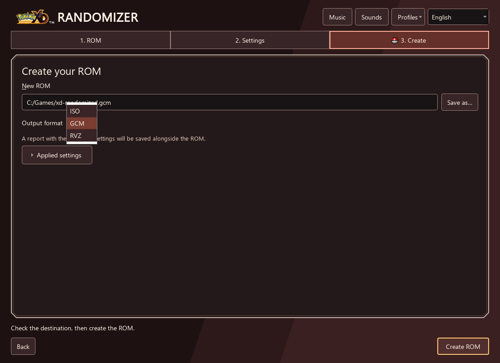 |

### A launcher for each run

Keep a run's ROM, memory card, save states and controls together. Dolphin is
detected automatically when possible, or selected manually. The launcher uses
that run's `DolphinUser/` profile; it never takes over your usual saves. All
generated file and folder names stay in English. Dolphin itself is not bundled.

Choose a base speed of 100% or 200%, hold **Tab** for 200% or **Shift + Tab**
for 50%, then release to return to your selected speed. Keyboard and XInput
controller presets can be remapped in Dolphin.

| Colosseum launcher | XD launcher |
| --- | --- |
|  |  |

The optional **Keep music at 100%** companion is available on Windows with
verified Europe revision-0 images and the checked renderer recipe. It separates gameplay music from
game speed; sound effects, cries and the complete picture/soundtrack of
prerecorded movies follow the game. It uses the original audio, not a HQ music
pack. Other configurations retain native audio. See the
[supported audio configuration and validation](docs/reverse-engineering/NATIVE_MUSIC_HOST.md).

### Shared HD packs

Install the optional HD packs from Home or either launcher. Each Orre release
pins specific upstream versions and SHA-256 hashes. Install once per game and
version, then reuse the pack across your runs; existing game folders keep their
recorded version. Downloads support cancellation and resuming.

HD packs by **Sephie** ([Colosseum, published by u/Bun-bun45](https://www.reddit.com/r/DolphinEmulator/comments/sxzxi2/))
and **mikeyX** ([XD/XG](https://forums.dolphin-emu.org/Thread-pokemon-xg-xd-hd-texture-pack-v1-0)).
Their work remains separately credited; see [HD sources and rights](docs/HD_SOURCES.md).

Custom x4 textures, portraits and whole-body artwork use the actual HD packs
as their source, including Shadow Lugia and its shiny variant. Native custom
models stay in the ROM. A model imported from the other game can require both
packs; missing custom artwork blocks HD preparation instead of substituting
an enlarged native image. These texture packs add no polygons or HQ audio.
**Original** mode needs no pack download.

HD mode adds localized type and status labels, battle controls, Pokémon sheets,
title menus and P-AD captions alongside the texture packs. XD's VS illustrations use the
game's character models and authentic hardware photos. New game folders also
support sharp vector lettering without changing dialogue layout.
Coverage varies by region and language, and some artwork remains native;
see [HD coverage and limitations](docs/HD_COVERAGE.md).
Prerecorded movies keep their original resolution. HD mode is not a complete
remaster of either game.

XD's **HD mode requires both packs**: XD supplies the textures and Colosseum
supplies HD portraits for all 386 base species and Unown forms, adapted to XD's
round frames. Clicking **Install** for XD installs both missing packs, reusing
any version already installed. Castform's weather forms and XD's additional
Deoxys forms also have paired normal/shiny x4 portraits. These portrait additions
do not replace missing stock 3D textures in the upstream packs.
Custom Shadow Lugia portraits match its normal/shiny colors at both
resolutions, with violet square frames in Colosseum and round frames in XD.
The DNA lab uses separate whole-body artwork with matching native/HD poses
and the keypad's black outline.


New game folders keep text sharp alongside the x4 artwork, with consistent
letter heights and the game's original spacing and line layout.

| Colosseum | XD |
| --- | --- |
|  | 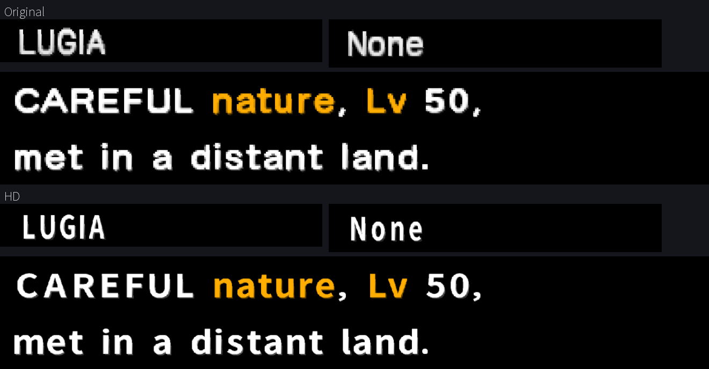 |


The Colosseum pack downloads about **0.72 GB**, XD about **3.30 GB**. The shared
cache also holds runtime and locally extracted music resources when supported.
Moving a game folder to another PC requires locating Dolphin and reinstalling
its shared resources. [Game-folder guide](docs/GAME_FOLDERS.md).

## Choose what changes

| | Pokémon + moves | Pokémon only |
| --- | --- | --- |
| Trainers, starters, Shadow Pokémon and ordinary gifts | Randomized | Randomized |
| Original legendary Shadow species | Preserved | Preserved |
| Legendary and Mythical Pokémon in random draws | Excluded | Excluded |
| Abilities | Randomized | Randomized |
| Evolution stages | All stages | All stages |
| Similar-strength matching | Disabled | Disabled |
| Family diversity | Enabled | Enabled |
| Seeded 5% shiny chance for supported encounters | Enabled | Enabled |
| XD Poké Spots: fresh 5% shiny chance per new wild encounter | Enabled | Enabled |
| Accessible evolutions and evolution stones in shops | Enabled | Enabled |
| Starting moves, level-up learnsets and TMs | Randomized | Preserved |
| Eligible treasure and shop items (original shop Poké Balls stay available) | Randomized | Preserved |
| Items already held by opponents, including Shadow Pokémon | Randomized | Preserved |
| Colosseum's bonus quest | Enabled; fixed team and Shadow Lugia | Enabled; fixed team and Shadow Lugia |

Both presets retain native opponent levels, battle EXP, purification speed and
catch rates. Starters can be unevolved, evolved or from a single-stage family;
neither preset requires a three-stage family. Colosseum's two starters keep
distinct families, without a power or shared-type constraint. XD has one starter. Its custom rate covers
the starter, ordinary gifts and Shadow Pokémon; the Shadow unlock can be
disabled separately. XD's Poké Spots roll a fresh **5% shiny chance for every
new wild encounter**, even for repeated encounters with the same species.
The field model shows its shiny appearance before battle. Set a separate
wild rate under **Advanced → Poké Spots**.
Family diversity is best effort when fixed Pokémon or strict filters
leave no alternative.
Original legendary Shadow Pokémon keep their species by default in both games.
Enable **Randomize legendary Shadow Pokémon** in Advanced to replace them;
XD001 remains protected for XD's story. Colosseum's bonus encounter has separate
controls for its team and final Shadow Pokémon.

All random replacements exclude Legendary and Mythical Pokémon, including
starters, Shadows, gifts and XD's Poké Spots. Enable **Legendary and Mythical
Pokémon** under **Advanced > Allowed Pokémon** to include them in random draws.
This filter does not remove fixed story encounters or Colosseum's bonus Lugia.

**Unchanged copy** preserves game data and can convert between ISO, GCM and RVZ. Imported
profiles keep their saved settings, including defaults from older versions.
Selecting a preset applies the current defaults.
Older Colosseum profiles with unlinked custom shinies now use their seed for
that rate, so previews, battles and supported story models can agree.

The full preset draws moves without matching power, physical/special stats or
the Pokémon's type. TM compatibility is randomized as well. It keeps an
attacking move and avoids duplicate moves; the self-destruct and one-hit-KO
exclusions are enabled by default and can be changed in Advanced.

The full preset also randomizes ordinary Ball treasures. Key items, Time Flutes,
guaranteed Evolution stones and other progression rewards remain protected.
Both presets keep every Poké Ball originally sold in shops. Turn off **Keep
original Poké Balls in shops** in Advanced to randomize those slots too; this
shop-only setting never protects Ball treasures.
Colosseum includes all nine regular cash shop inventories, including the three
type-2 shop lists. Herbalists, vending machines and coupon shops stay unchanged.
Pokémon without a held item stay empty-handed.
Treasure replacements draw across eligible item categories and prices; enable
similar-value matching in Advanced to constrain the pool.

Trade evolutions and other unavailable routes are adapted so you can finish
your team in the game you're playing. Evolution stones are added to shops in
Phenac and Pyrite in Colosseum, and Gateon Port in XD. Each Pokémon's sheet
lists its final evolution requirements, with normal or shiny portraits.

| Colosseum · Simple settings | XD · Simple settings |
| --- | --- |
|  | 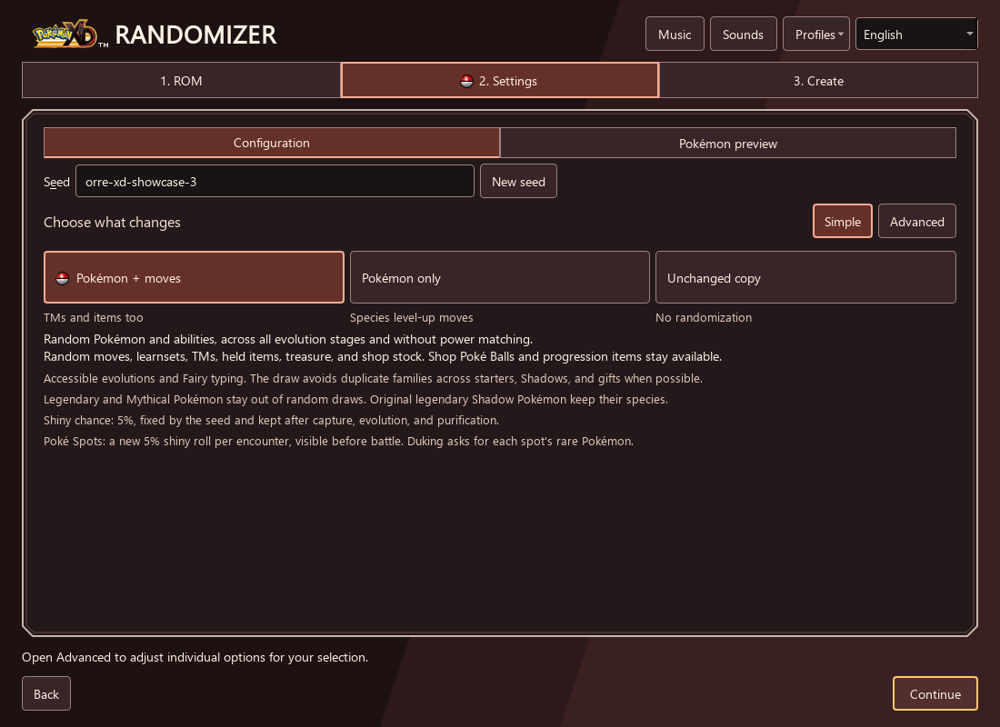 |

### Preview your run

Check your starters, gifts and Shadow Pokémon before creating the ROM. Both
games show the full Shadow roster, with 48 entries in Colosseum and 83 in XD.
With an original ROM selected, Pokémon kept by your settings load automatically,
including their sheets and seeded shiny appearance. Randomized replacements
are calculated only when you click **Calculate preview**. Loading the preview
page does not draw those replacements or prepare the complete ROM.

Pokémon whose species is kept by your settings retain their native abilities,
moves, TM moves, types and base stats; your shiny settings still apply. Enable
**Randomize preserved Pokémon’s properties** in **Advanced > Allowed Pokémon**
to apply the selected property rules to them too. Species tables are shared:
retaining a species protects its evolution family and every copy of those
species. Evolution accessibility rules still apply.

The fixed-encounter examples below use a 100% shiny rate.

| Colosseum - fixed encounters | XD - fixed encounters |
| --- | --- |
| 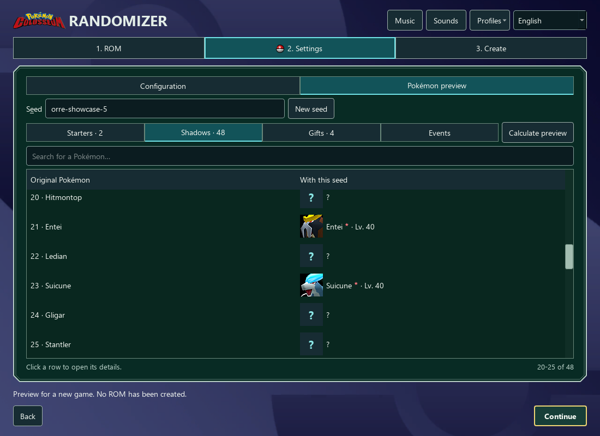 |  |

Colosseum's **Events** tab lets you preview or disable the
[Shadow Lugia quest](#a-new-postgame-battle-in-colosseum), including the boss's team.
Click a Shadow Pokémon or gift to open its Pokémon sheet. In XD you can also
check Poké Spot encounters and see what Duking wants in each trade.

| Colosseum | XD |
| --- | --- |
|  |  |
| 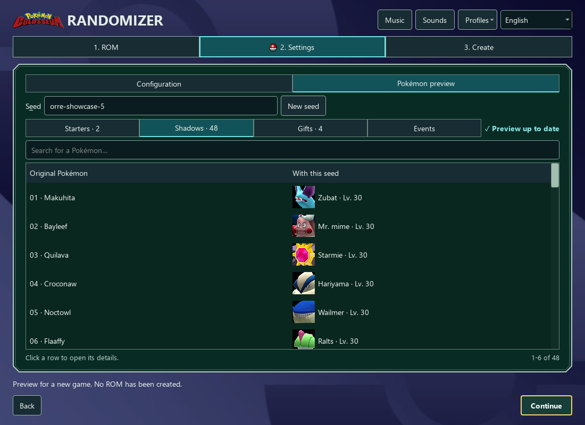 |  |
|  |  |

Gift requirements have their own column, including Plusle's story reward,
Ho-Oh's Mt. Battle requirements and the purification rewards. XD's Poké Spot
preview groups each location and encounter rate beside the replacement.


Colosseum's event gifts no longer need a distribution disc. With **Make event
gifts obtainable** enabled, Eagun offers the Pikachu gift after 10 purifications
and the Celebi gift after 25 at the Relic Stone. Both can be randomized, and
you can change their thresholds and levels. His original story conversations,
contact exchange and Master Ball handoff keep priority over the added rewards.

## In game

Start a new game with a different team in either Colosseum or XD. Your starters,
opponents and snag targets follow the settings you chose.

| Pokémon Colosseum | Pokémon XD |
| --- | --- |
| 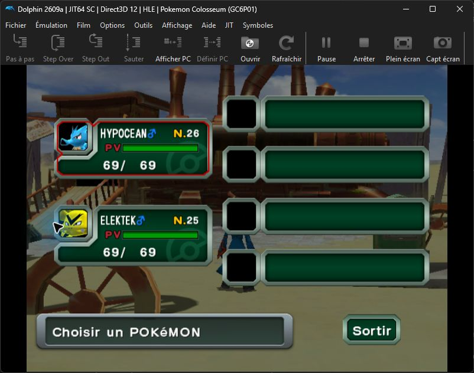 | 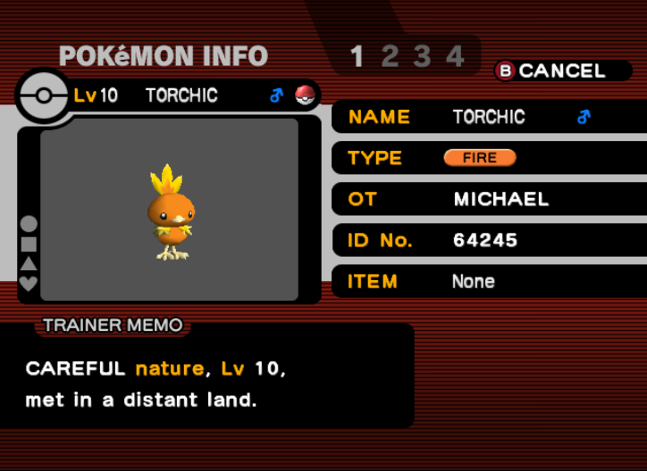 |

### Randomized Pokémon in story scenes

Your randomized Pokémon can show up outside battle, too. In supported scenes,
the models and dialogue follow your run, from the starters riding in the
sidecar at Outskirt Stand to the Pokémon Duking gives you in Pyrite. Miror B.'s
dancers also change with his team in Pyrite Cave and at Gateon Port's lighthouse.
Trainer dialogue follows randomized teams, including references to their
Pokémon's types and moves. XD's Battle Simulator lessons also follow their
new rental teams.

Unown's letter comes from the seed in both games. Spinda's spots follow its
in-game personality value, and the Pokémon sheet shows the exact pattern when
it can be determined before play. [Forms and shiny rules](docs/SHINIES.md)

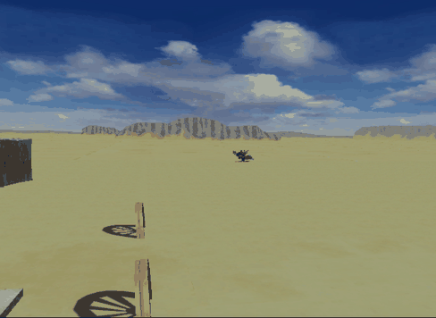

[View the motorcycle still](docs/images/colosseum-motorcycle-starters.png)


| Colosseum · Pyrite Cave | XD · Gateon Port Lighthouse |
| --- | --- |
| 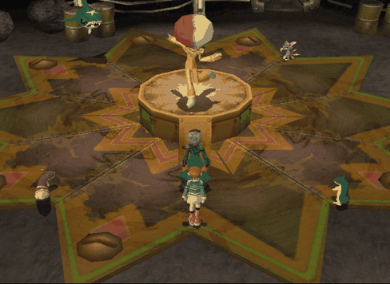 | 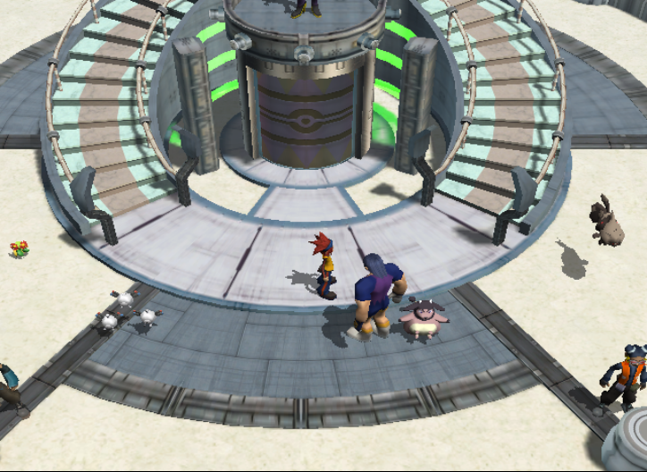 |

[View the Pyrite Cave still](docs/images/colosseum-pyrite-dancers.png)

At XD's Poké Spots, you can spot a shiny in the field before you battle it.

| Cave Poké Spot | Wild battle |
| --- | --- |
|  |  |

[Story-scene support](docs/reverse-engineering/STORY_GIFT_SCENES.md) ·
[Showcase seeds](docs/images/manifest.json)

### Choose your shiny odds

Both randomizing presets start at **5%** for supported encounters. Set your
own rate from 0% to 100% in Advanced, including XD's normally shiny-locked
Shadow Pokémon. The seed fixes their result, and a shiny stays shiny after
you snag it, evolve it or purify it. XD's wild Poké Spot rate is a separate
setting, also enabled at 5% by default. It rolls again for every new encounter;
the same Pokémon keeps its shiny status on the field, in battle and after capture.

Shadow Lugia uses its dark XD model in both games, with a custom white-and-black
shiny variant and matching portraits. Purification normally restores its
ordinary appearance, pink when shiny. Enable **Keep Lugia's Shadow appearance**
to keep the dark model after purification instead. This appearance-only
option is off by default; Lugia that were never Shadow Pokémon keep their
ordinary models. [Shiny and form rules](docs/SHINIES.md)

| Shiny settings | Purified Lugia with its Shadow appearance kept |
| --- | --- |
| 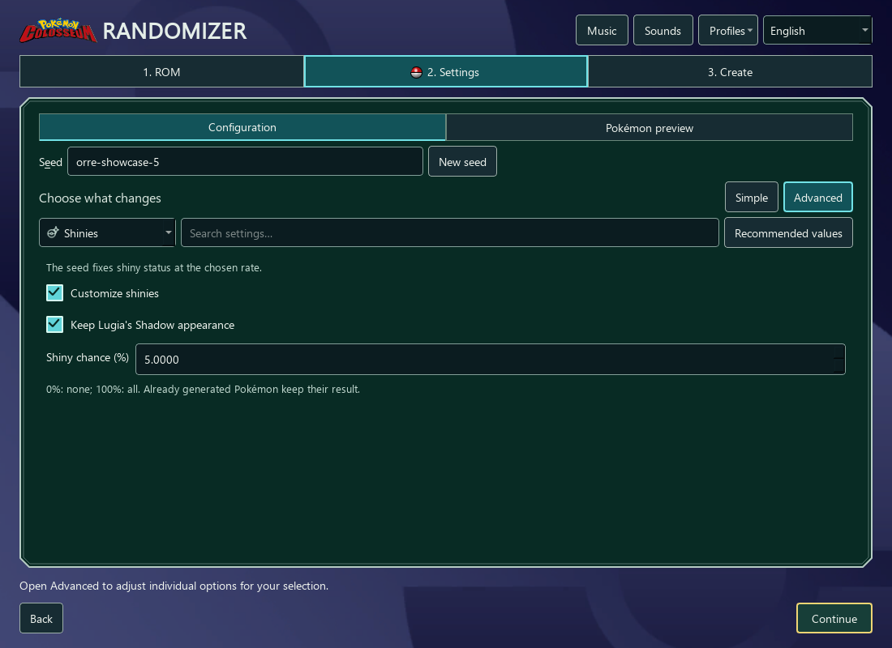 |  |

**Custom shiny Shadow Lugia (XD001) model**

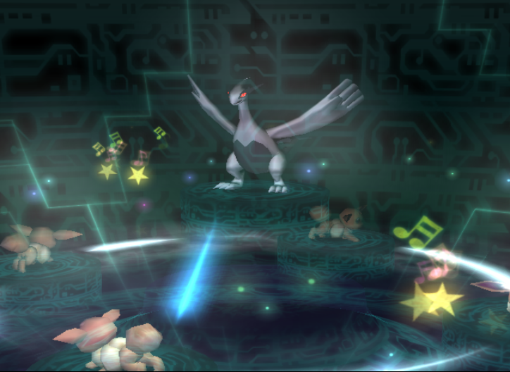

### A new postgame battle in Colosseum

Cipher has one last plan for the Relic Stone. After you snag and purify all
48 original Shadow Pokémon, a motorcycle trip to another area brings a P★DA
warning from Eagun. Return to Agate to face Nascour and **level-70 Shadow
Lugia** in a new scene with your partner and Eagun.

| Cipher's last stand | After the capture |
| --- | --- |
|  | 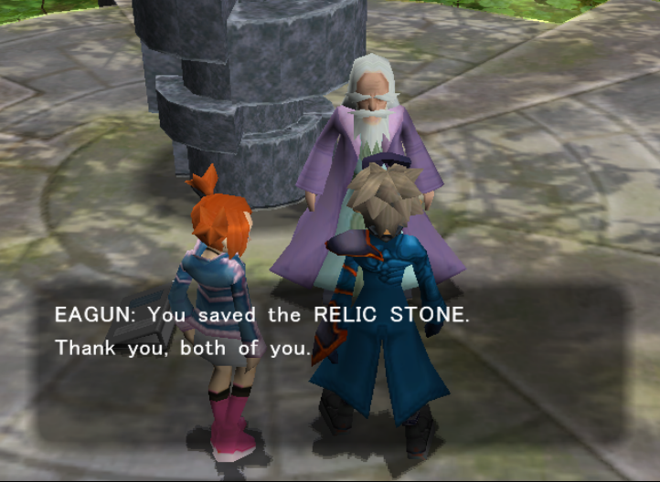 |

Both randomizing presets enable this quest with its intended six-Pokémon team
at levels 65-70 and Shadow Lugia as the final target. Under **Advanced → Starters
and gifts**, independently enable **Randomize Nascour's team** to replace his
first five Pokémon or **Randomize the bonus battle's Lugia** to replace the
final Shadow Pokémon. Both switches are off by default. The scene model,
dialogue and encounter follow the final replacement.
Miss the capture and you can challenge him again. Snag the final Shadow Pokémon
and Nascour leaves the shrine for good. Eagun resumes his purification rewards.
The new Shadow Pokémon can then be purified normally;
the original Ho-Oh requirements still count the original 48. Use **Pokémon
preview → Events** to inspect the team or disable the quest.
[Quest guide](docs/USER_GUIDE.md#colosseums-optional-shadow-lugia-event)

## What you can customize

- **Pokémon:** species, evolution stages, generations, legendary restrictions,
  excluded species and types, similar strength, and evolution-family diversity.
- **Battle data:** moves, learnsets, TMs, compatibility, abilities, types, base
  stats, held items, trainer themes, boss teams and opponent level scaling.
- **Progression:** obtainable evolutions, evolution stones, battle EXP,
  purification speed, catch rates, treasure and shop stock.
- **Your run:** reproducible seeds, profile import/export, encounter previews,
  Pokémon sheets, verification reports and an offline HTML journal.

Both games use the same three-page layout and Pokémon sheets, with their own
logos, backgrounds and title music. The included interface pack works before
you select a ROM. **Music** and **Sounds** have separate saved preferences.

| Game-specific behavior | Colosseum | XD |
| --- | --- | --- |
| Starters | Two, originally Umbreon and Espeon | One, originally Eevee |
| Shadow roster | 48 synchronized Shadow groups; original legendaries preserved by default | 83 Shadow encounters; original legendaries preserved by default, XD001 always protected |
| Gifts and trades | Plusle, Ho-Oh, Pikachu and Celebi | Duking's trades, Hordel's trade and Mt. Battle prizes |
| Special encounters | Event gifts can be earned from Eagun after purification milestones | Tutorial Teddiursa and Hordel's Shadow Togepi are randomized by default; each can be disabled separately |
| Poké Spots | — | Draw from the full supported Pokédex, subject to filters and power matching; Duking's requests follow the new rare slots |

The [user guide](docs/USER_GUIDE.md) explains these rules and their limits.
Pokémon sheets read the final patched game data, including evolution routes,
moves and TM compatibility. The Summary and Moves tabs show the original ability
and move descriptions in your interface language.

| Colosseum | XD |
| --- | --- |
| 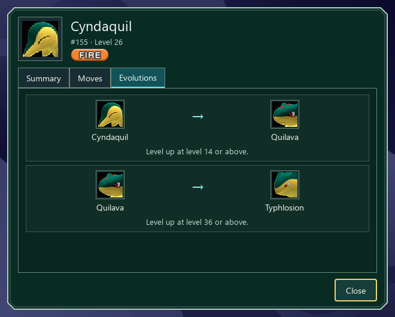 |  |
| 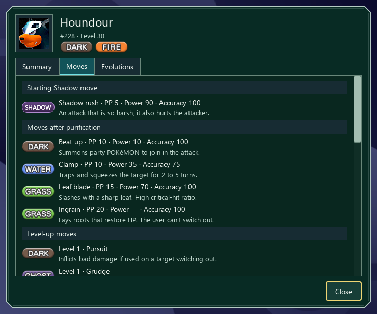 | 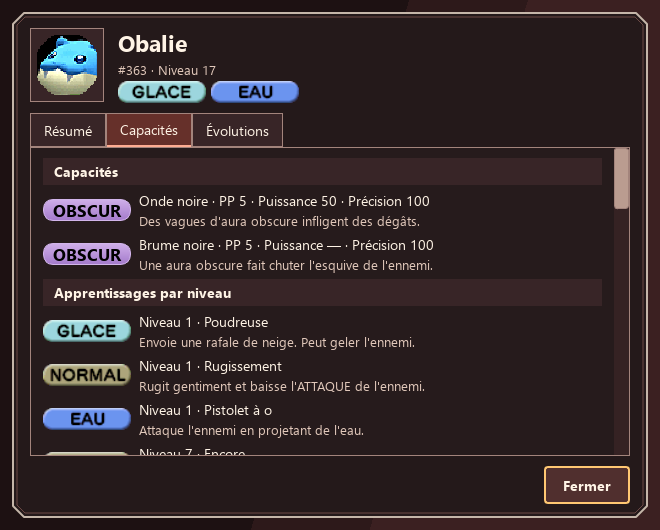 |

### Advanced settings

Choose a category or search for an option. Each category can be reset on its
own. Switch to Advanced whenever you want more control over the preset.

| Colosseum · Move settings | XD · Move settings |
| --- | --- |
|  |  |

## Compatibility and languages

Supported originals are **revision 0** of both games in **Europe, USA and Japan**:

| Game | Europe | USA | Japan |
| --- | --- | --- | --- |
| Colosseum | `GC6P01` | `GC6E01` | `GC6J01` |
| XD | `GXXP01` | `GXXE01` | `GXXJ01` |

The full decoded ISO hash must match a supported original. Modified images and
unknown revisions are rejected. See [exact hashes and compatibility](docs/COMPATIBILITY.md).

The interface supports **English, French, German, Spanish, Italian and Japanese**.
It follows your system language, falls back to English, and can be changed at
any time. This does not change the ROM's language. In-game names and patched
dialogue follow the languages supported by that ROM.

## Reproducing a run

Keep the output's `.json` report or export a profile from **Profiles**.
The same original image, seed, settings and engine version produce the same
decoded disc. RVZ compression bytes can also depend on the bundled converter
version, which is recorded in the creation report.
Seeds are exact text: case and spaces matter. Existing saves can retain
Pokémon already generated by the game, so use a new game to match the preview.

Automated checks cover both engines, six interface languages, packaging,
profile compatibility and isolated Windows application startup. Selected
scenarios have also been checked in Dolphin. These are not full playthroughs
of every region or seed; [validation scope and evidence](docs/VALIDATION.md)
describe what was tested.

## Run from source

Use Python 3.12 or later:

```powershell
python -m venv .venv
.\.venv\Scripts\Activate.ps1
python -m pip install -e .
python -m orre_randomizer
```

Raw ISO/GCM processing works with the Python LZSS codec. To enable RVZ conversion
and the LZSS accelerator in a source checkout, install Rust and a C/C++ toolchain
(MSVC on Windows), then run `python scripts/build_native.py`. This fetches pinned
build dependencies once. The distributed Windows app includes both libraries
and converts offline. Both LZSS codecs produce the same bytes.

The CLI uses the same engines. A profile reproduces the GUI's exact settings:

```powershell
python -m orre_randomizer.cli original.iso new-game.iso --profile my-run.json
python -m orre_randomizer.cli xd-original.iso xd-new.iso --game xd --profile my-xd-run.json
python -m orre_randomizer.cli --help
python -X utf8 scripts/run_tests.py
```

See [Contributing](CONTRIBUTING.md), the [release guide](docs/RELEASE.md), and
[research notes](RESEARCH.md). Report issues with the version, game, region,
seed and relevant settings. Review reports for local paths before sharing them.

The application code and original Orre branding are [MIT licensed](LICENSE).
The bundled game interface media and third-party libraries have separate
rights and provenance; see [third-party notices](THIRD_PARTY_NOTICES.md).
