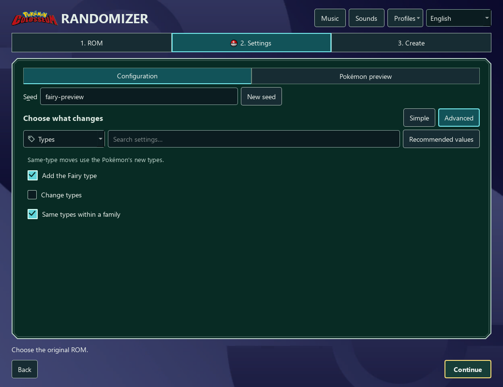
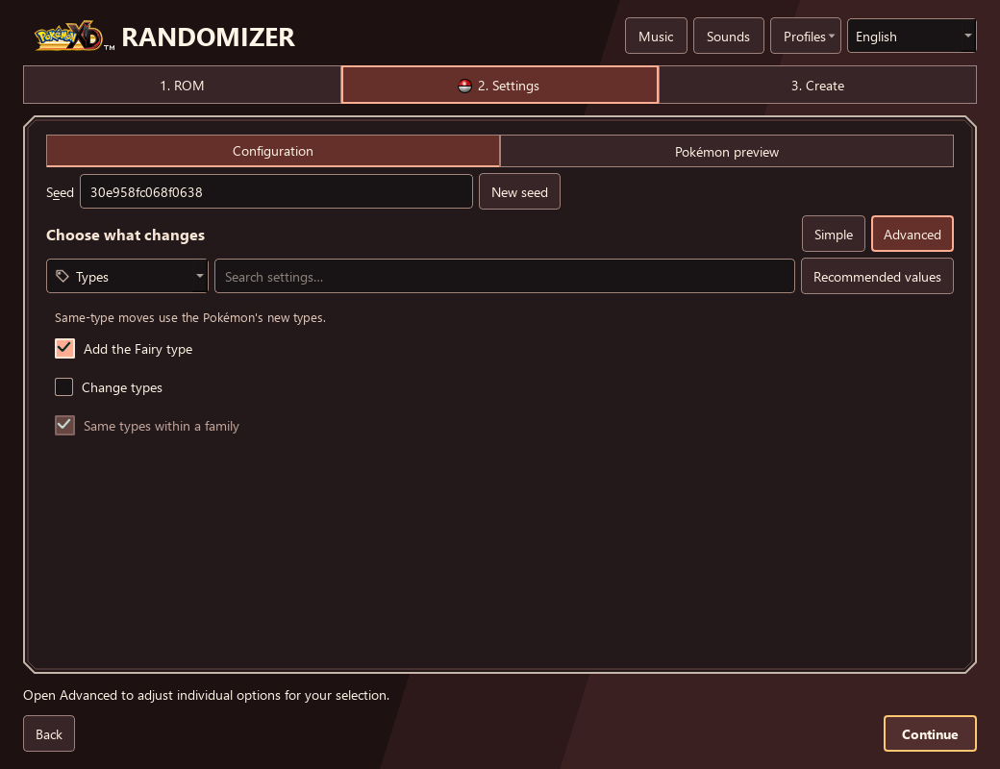

# Optional Fairy rules

Available from v2.1.5 in both games.

In either game's **Advanced > Types**, select **Add the Fairy type**. The option
is off in both randomized presets. It is separate from **Change types**.

| Colosseum | XD |
| --- | --- |
|  |  |

The option adds Fairy's attacking and defending matchups, updates the 18
affected existing species, and changes Sweet Kiss, Charm and Moonlight to
Fairy. Other generation III type matchups remain unchanged. It adds no species
or evolutions from later generations.

## Moves and TMs

Seven new ordinary moves have their own names, descriptions, PP and effects.
They use existing game animations chosen for this first version.
The desktop sheets retain the full reference descriptions. The games use
shorter six-language descriptions, wrapped to their own move and Bag panels
using the original fonts. The added moves have no Contest performance.

| TM | Move | Category | Animation reused |
| --- | --- | --- | --- |
| 51 | Disarming Voice | Special | Hyper Voice |
| 52 | Draining Kiss | Special | Sweet Kiss |
| 53 | Play Rough | Physical | Body Slam |
| 54 | Fairy Wind | Special | Gust |
| 55 | Moonblast | Special | Mist Ball |
| 56 | Dazzling Gleam | Special | Swift |
| 57 | Baby-Doll Eyes | Status | Charm |

Play Rough uses Attack and Defense, including the matching Hustle and Counter
rules. Existing moves keep their generation III damage categories.

The original 50 TMs and these seven additions share one seeded shuffle when
TM randomization is enabled. Move descriptions and compatibility follow the
selected move. The eight existing HM records stay separate and unchanged.

The extra TMs are ordinary items: they can appear in randomized treasure and
cash-shop item pools. They are also added to Phenac's cash shop in Colosseum
and Gateon's cash shops in XD, including later story inventories. Original
stock and Balls are retained. Original TM reward slots can teach an added
move through the same 57-TM shuffle.

## Learning and appearances

The natural-learning reference is Brilliant Diamond / Shining Pearl, covering
all 386 existing species. Fairy additions are merged with the games' original
moves and levels. Learning is never truncated to fit a row. Togetic's Fairy
Wind and Gardevoir's Dazzling Gleam also have explicit evolution events offered
through the original learn/forget dialogue.

Actual Dolphin tests in both games cover learning these evolution moves into
an empty slot, replacing an existing move, refusing a move, and saving the
result, including after a cold restart. These tests use copied cards; Pokémon
identity and shiny status are retained.

New-TM compatibility uses the reference species' learnability by level,
evolution, breeding or machine. The app's compatibility setting can override
that baseline for randomized species. Preserved Pokémon retain their own
compatibility unless their advanced property-randomization option is enabled.
XD's fixed rental challenges retain their original species traits so their
lessons, Battle CDs and Battle Bingo remain playable.

Native and independently rendered x4 Fairy badges are available in English,
French, German, Spanish, Italian and Japanese. XD has a separate small battle
badge. Original badges and their abbreviations are retained. Previews, Pokémon
sheets and journals use the same types, moves and TM plan as the generated ROM.
New game text follows the ROM: Japanese on Japanese discs, English on USA
discs, and the selected in-game language on European discs.

Pokémon that know an added move cannot be transferred to a generation III GBA
game. The transfer screen explains the refusal using native game text. This
does not block capture, evolution, purification, the story or saving.

## Implementation and validation

The original REL and DOL remain the authenticated reference. The content uses
separate type, move and item identities; it preserves the Shadow and Mystery
type IDs, save layouts, original videos and original input files. Disabling
the option retains the existing generation path. Older profiles import it as
disabled.

The 127 targeted tests cover all language data, native/x4 badge bindings,
compatibility permutation, move/category hooks, bounded evolution queues and
thread-local preview contexts. Private retail preflights cover all six original
regional DOL/REL pairs. Both presets also pass complete patch generation for
all six regional releases with the option enabled. These checks use the
original source discs and remove temporary decoded RVZ copies; they do not
write randomized disc images.

Muted Dolphin checks on European copies cover all seven moves in both games,
their animations, targeting and PP use, teaching an added TM, evolution
learning, saving and reloading. XD battle checks also cover Soundproof,
Substitute, Draining Kiss's 75% healing and Liquid Ooze reversal, Play Rough's
physical category with Hustle, and Fairy's immunity to Dragon Rage. Native
English descriptions and both games' independent x4 badges have been inspected.
Separate USA and Japanese Dolphin checks cover loading, localized move names,
descriptions and native type badges in both games. Colosseum Japan's summary
also uses its native name-to-badge conversion path.
An XD comparison uses the same disc, saved state and internal resolution with
texture replacements enabled and disabled: the native Psychic badge stays
identical while the Fairy badge uses its separate x4 image.

Added TMs have also been bought through the native shops in both games. TM51
costs 3,000 and increases the Bag quantity by one; Colosseum also covers TM52.
Cancelling an evolution has been observed in both games. In Colosseum, Kirlia
stays Kirlia after gaining a level, does not learn Dazzling Gleam, and retains
its identity, shiny status and moves after a native save.

These checks are separate from a full playthrough or six regional playthroughs.
The GBA transfer guard has native table/PowerPC tests; a connected GBA transfer
has not been tested.

Data sources and licenses are documented in
[`assets/rules/fairy`](../orre_randomizer/assets/rules/fairy/README.md) and the
[third-party notices](../THIRD_PARTY_NOTICES.md#fairy-reference-data-and-badge-artwork).
