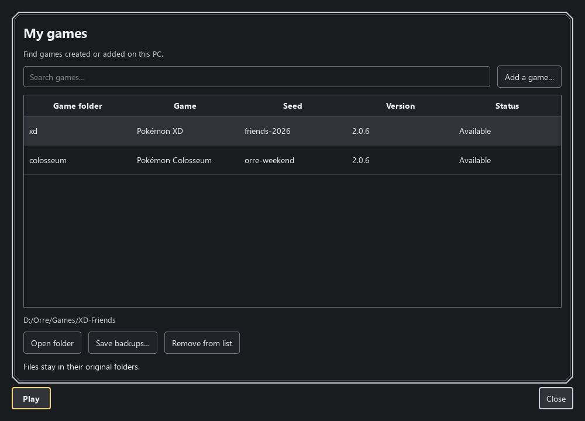
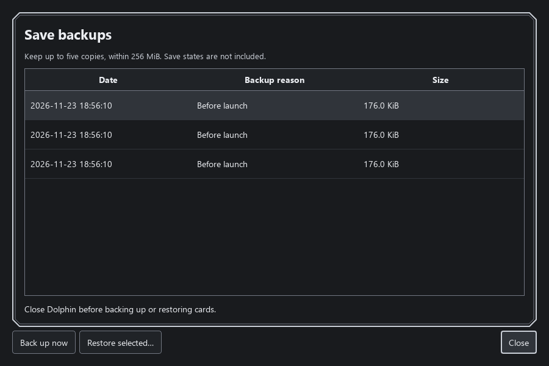
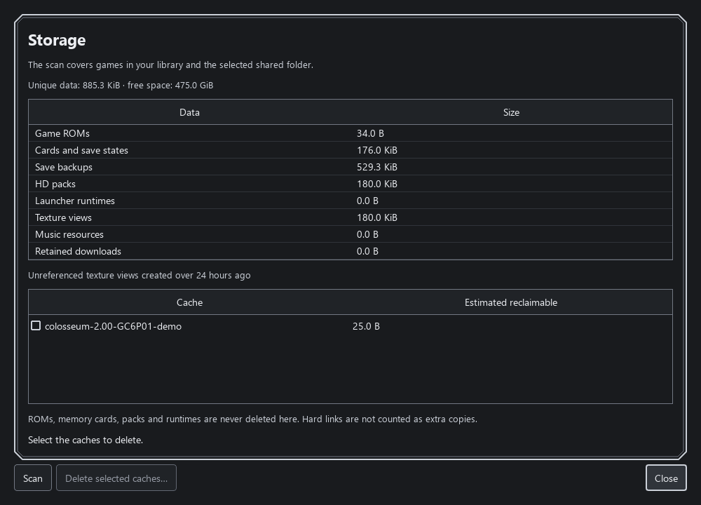
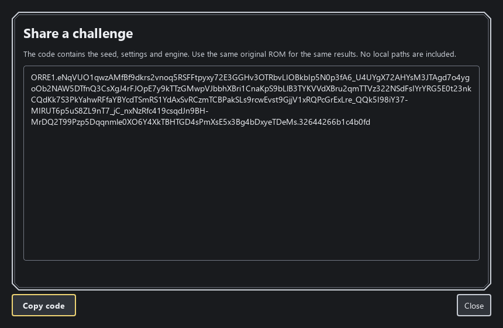

# Games, save backups, storage and challenge codes

Available from v2.1.0, these tools use the same six
interface languages as the randomizer. Screenshots use synthetic demonstration
data, not a player's ROM, save or personal directory.

## My games

Open **My games** on Home. New game folders created through the app and folders
opened through **Open launcher** are added automatically. Use **Add a game...**
to select an existing folder's `game.json`. Orre does not search your drives.

Search by name, game, seed or version. Select a row to open its launcher,
reveal its folder or manage its save backups. The version column identifies
the launcher runtime, which can differ from the version that created the ROM.
Missing folders remain listed so you can recognize them. **Remove from list**
forgets the reference without deleting the folder or its contents.

The library is a local SQLite index next to the app's preferences. It contains
folder references and display metadata. It uploads nothing and does not move
or duplicate ROMs. CLI-created folders can be added manually.

## Memory-card backups

**Back up cards before playing** is enabled by default in the updated launcher.
After launch preparation and before Dolphin starts, Orre copies the run's
existing raw memory cards into `SaveBackups/`. An initial run without a card
can start normally; create an in-game save before a backup can exist.

Each snapshot records the game ID, seed, ROM digest, card sizes and SHA-256
checksums. Identical, intact cards reuse the newest snapshot. Retention keeps
up to five snapshots within 256 MiB of card data. Cards are limited to 128 MiB
each and 256 MiB per snapshot. These limits keep the backup history bounded;
ROMs and emulator save states are not copied.

Open **Save backups...** from the launcher or My games to create a manual copy
or restore a selected snapshot. Close the run's launcher and Dolphin before
restoring from My games. The launcher also provides access before playing.
Orre verifies the snapshot and its run identity, stages its cards, and backs up
the current cards before replacing them. A failed multi-card publication rolls
back completed replacements. A backup failure prevents the automatic launch;
the launcher keeps its error visible and the checkbox can be disabled explicitly.

Run locks, emulator-process checks, linked-path rejection and exclusive card
reads protect the operation. An emulator with unreadable ownership information
causes refusal rather than an assumed idle state. These process checks are
supported on Windows and Linux; other hosts can leave automatic backups off.
Save states stay untouched. After restoring a card, continue through the game's
normal load menu rather than loading a later emulator state.

Existing standalone ROMs and older cached launchers do not acquire this feature
automatically. Update the run's launcher explicitly to use the new controls.

## Storage

Open **Storage** on Home. A background scan reports the library's ROMs, cards,
save states and backups, plus the selected shared directory's packs, runtimes,
texture views, music resources and retained downloads. The default selection
is the shared directory set in **HD packs**. This is an inventory of those
locations, not a whole-drive scan.

Hard-linked files count once in the unique-data total. Category figures can
overlap because a texture view can share files with a pack. Reclaimable space
is estimated conservatively from link counts; a view's logical size is not the
amount that deleting it will necessarily free.

Cleanup offers only completed, rebuildable texture views created more than
24 hours ago and not referenced by the registered runs' saved load paths.
No item is preselected. Review the names, check the desired rows and confirm
**Delete selected caches...**. Orre checks references and file metadata again
before deletion. Active emulators, locked runs, an HD installation, linked paths,
changed candidates or an unavailable library entry prevent cleanup. Remove a
missing reference from My games before scanning again.
A library changed by another app instance also requires a fresh scan before
cleanup, so a newly added run cannot be overlooked.

ROMs, saves, backups, installed packs, runtimes, audio banks and downloads are
not deletion targets. Unregistered older runs can rebuild a removed texture
view from their retained pinned packs when next launched. Cancelling cleanup
stops between candidates; caches already removed remain removed.

## Share a challenge

In either game's **Profiles** menu, choose **Share a challenge...**, then
**Copy code**. Send the text to a friend. They can use **Import a challenge**
on Home, or the matching Profiles action. Orre identifies the game and restores
its seed and randomization options after validating the complete code.

The compact `ORRE1` code stores every option, the exact seed, the producing app
version and the engine version. A field-layout digest prevents an option from
being silently assigned to a different field. Compression and decoding are
bounded, and a checksum detects damaged codes. This checksum is an integrity
check, not proof of who created the code.

Codes contain no ROM, save, local path, Dolphin setting or HD-cache location.
Matching results require the same original ROM and engine. Different engines
or field layouts are refused rather than silently migrating the challenge.
Existing JSON profiles remain available, including their historical migration
behavior. Sharing a challenge does not create multiplayer or synchronize saves.

